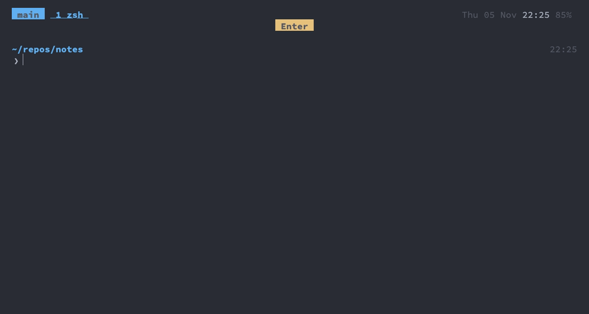

dotfiles
===

A keyboard-driven macOS development setup for Apple silicon. Ghostty opens straight into tmux, tmux holds
the shells, nvim sessions and Claude Code agents, and one base16 colour scheme is shared by all of them.

<details>
<summary><b>Show GIF</b></summary>

A quick tour: `cmd+k` opens a project as a session, `git diff` through delta, `;f` finds a file in nvim,
`cmd+d` puts a shell next to it, `C-h` and `C-l` cross between them, `cmd+w` closes the nvim pane, `lg` opens
lazygit, `cmd+j` shows every session.



</details>

| Layer | Tool | Docs |
|---|---|---|
| Install and update | Homebrew (`Brewfile`), `setup_dotfiles`, `check_dotfiles` (also CI) | [setup](docs/setup.md) |
| Terminal | Ghostty | [ghostty](docs/ghostty.md) |
| Sessions, windows, panes | tmux + session picker | [tmux](docs/tmux.md) |
| Shell | zsh (no framework, vi mode), starship, atuin, zoxide, fnm, uv | [zsh](docs/zsh.md) |
| Fuzzy finding | fzf, fzf-tab, fd, bat, eza | [fzf](docs/fzf.md) |
| Editor | Neovim (lazy.nvim, LSP, treesitter, telescope) | [neovim](docs/neovim.md) |
| Version control | git, delta, difftastic, lazygit, gh, Secretive (SSH keys) | [git](docs/git.md) |
| AI agents | Claude Code in tmux windows and git worktrees | [claude-code](docs/claude-code.md) |
| iOS and Android apps | nvim (sourcekit-lsp, xcodebuild.nvim; kotlin-lsp, Gradle) next to Xcode and Android Studio | [mobile](docs/mobile.md) |
| Vim keys everywhere | nvim's keys in VS Code (vim extension) and Android Studio (IdeaVim) | [vim-keys](docs/vim-keys.md) |
| Google Cloud | gcloud, bq, gsutil on work Macs; Claude Code reads, can't change | [gcloud](docs/gcloud.md) |
| Debugging | VS Code next to nvim (`,vo`), for backends and the web | [debugging](docs/debugging.md) |
| Colours | base16 scheme for nvim, Ghostty and everything else | [theme](docs/theme.md) |
| Window manager | AeroSpace (tiling, workspaces, SIP stays on) | [window-management](docs/window-management.md) |
| GIFs in these docs | VHS tapes, rendered by `make_gifs` | [gifs](docs/gifs.md) |

Install from scratch
---
**Fork this repo first** and change at least the git identity in `config/git/.gitconfig`: it is set up for
one person.

```sh
git clone <your fork> ~/repos/dotfiles && cd ~/repos/dotfiles
./prepare-zsh-install.sh   # Homebrew, zsh, links ~/.zshrc, makes zsh the login shell
exec zsh
setup_dotfiles             # asks the Mac's name and kind once, then everything; rerun after `git pull`
```

Then follow [A new Mac](docs/setup.md#a-new-mac): Accessibility access, the SSH keys in Secretive and what
only this Mac needs. [docs/setup.md](docs/setup.md) also lists what each step does and every symlink.

How the keyboard is split
---
Every tool owns its own modifier, so the layers don't fight over keys:

| Keys | Owner | Examples |
|---|---|---|
| `Cmd` | Ghostty, translated into tmux commands | `cmd+t` new window, `cmd+d` split, `cmd+k` session picker |
| `C-a` | tmux prefix | `C-a f` session picker, `C-a w` session tree, `C-a z` zoom |
| `C-h/j/k/l` | tmux panes *and* nvim splits, seamlessly | |
| `Option` (Alt) | AeroSpace, globally | `alt+h` focus window left, `alt+2` workspace 2 |
| `Caps Lock` | remapped to Ctrl | |
| `,` | nvim leader | `,e` file tree, `,lg` lazygit |
| `;` | nvim pickers (telescope, harpoon) | `;f` files, `;r` grep |
| `jj` | leave insert mode, in nvim, zsh, Claude Code, VS Code, Android Studio and the fzf pickers (`cmd+k`, `cmd+j`, `cmd+shift+j`, `C-r`) | |
| `C-r` / `C-t` | history (atuin's, in fzf), files, in zsh | |

Same key, every layer
---
A move you know on one layer works on the others: the key stays the same and the modifier picks the layer,
from nvim splits up to AeroSpace workspaces. A new key joins one of these families where it can.

| Key | nvim splits | tmux panes | tmux windows | AeroSpace |
|---|---|---|---|---|
| `Space`: the next one, cycling | `Space` | `C-Space` | – (`cmd+space` is Spotlight; `cmd+]`; agents that need you: `cmd+shift+space`) | `alt+space` (windows on the workspace) |
| `h/j/k/l`: the one in that direction | `C-h/j/k/l` | `C-h/j/k/l` | – | `alt+h/j/k/l` (windows) |
| `[` / `]`: previous / next | – (`[` / `]` start nvim's motions) | – (`ctrl+[` is Esc) | `cmd+[` / `cmd+]` (sessions: none, too easy to mix up with windows) | `alt+[` / `alt+]` (workspaces with windows) |
| `1`…`9`: by number | a count: `3 Space` | – (`C-h/j/k/l` is enough) | `cmd+1`…`9` | `alt+1`…`9` (workspaces) |
| `0`: back to the last one | `Backspace` (`0` is start of line) | `ctrl+0` | `cmd+0` (sessions: `cmd+shift+0`) | `alt+0` (workspace) |

`Space` and `Backspace` in nvim do the same in VS Code and Android Studio ([vim keys](docs/vim-keys.md); VS Code
goes to the previous editor group, as it doesn't track the last one). `C-Space` goes to tmux in every pane,
nvim's too, so nvim's completion opens with `Tab` instead.

Switching sessions and windows
---
| Key | Action |
|---|---|
| `cmd+j` | every session and window as tmux's tree, in fzf with a live preview; `j`/`k` move, `/` filters, `Enter` switches |
| `cmd+shift+j` | only the Claude Code agents, most urgent first: their state, what each works on, a live preview of its screen |
| `cmd+shift+space` | the next agent that needs you, in any session: waiting ones first, then done ones; again for the one after |
| `cmd+k` | fuzzy-find a running session or a project directory, which becomes a session (`tm` outside tmux) |
| `cmd+[` / `cmd+]`, `cmd+1`…`9` | previous / next window, window by number |
| `cmd+0` / `cmd+shift+0` | back to the last window / session |
| `cmd+r` / `cmd+shift+r` | rename the window / session |

More in [tmux](docs/tmux.md#keys).

A typical day
---
1. Open Ghostty: you land in the tmux session `main`, exactly as you left it, even after a reboot.
2. `cmd+k`, type part of a project name: a tmux session for that directory opens (or is reused).
3. `vim .` in one window, `cmd+d` for a shell next to it, `C-h`/`C-l` to move between them.
4. `agent fix-login "the login form rejects valid emails"` starts Claude Code in its own worktree and
   window; its state shows on the window, the session and the status bar: waiting for you, done, working.

Repository layout
---
```
Brewfile                  every package and app, commented by purpose
prepare-zsh-install.sh    first-run bootstrap (bash, before zsh exists)
.zshrc                    sources zsh/*; everything else is linked from config/
zsh/                      shell config, aliases, functions (setup_dotfiles lives in .functions)
config/atuin/             shell history search
.fzf.zsh                  fzf and fzf-tab configuration
config/ghostty/           Ghostty config and the generated base16 theme
config/tmux/              tmux.conf and the session picker
config/nvim/              Neovim: one directory per plugin under lua/user/
config/starship.toml      prompt
config/git/.gitconfig     git
config/ssh/config         ssh: Secretive agent, which key for which host
config/aerospace/         window manager
config/vscode/            VS Code, the debugger: settings (with nvim's keys) and the extensions to install
config/ideavim/           nvim's keys in Android Studio (IdeaVim)
config/claude/            Claude Code: settings, global CLAUDE.md, hooks, status line
config/machine/           templates for this Mac's own files in ~/.config/dotfiles
docs/                     this documentation; tapes/ and img/ are the GIFs in it
checks/                   check_dotfiles: the checks run before a commit and on CI
CLAUDE.md                 instructions for Claude Code working on this repo
```

The same repo serves any number of Macs, e.g. one for home and one for work. What only one Mac needs (work email,
work plugins for Claude Code, extra packages, shell settings) lives outside the repo in `~/.config/dotfiles`,
see [setup](docs/setup.md#several-macs). Secrets go in files that are gitignored and loaded when
present: `zsh/.private` (shell, e.g. tokens) and `config/nvim/lua/user/hidden/init.lua` (nvim).
