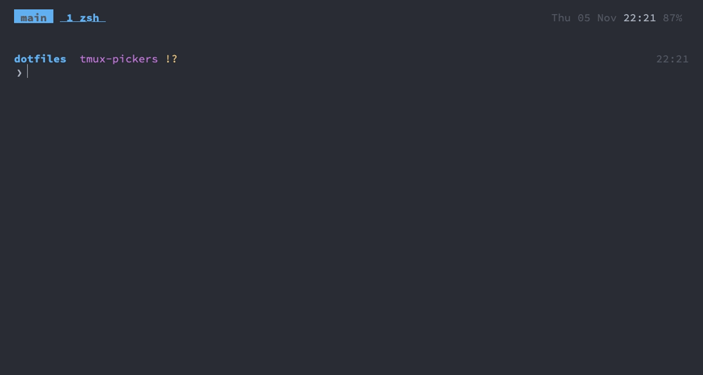

Agents
===

The terminal setup is built so several coding agents can run side by side without getting in each other's way,
and so you notice when one of them needs you. The job, worktrees, windows, marks, review, resume and landing,
belongs to this layer; the tool that does the coding is a plug-in, [Claude Code](claude.md) by default.

<details>
<summary><b>Show GIF</b></summary>

`agent` starts Claude Code in a worktree and window, the window turns yellow when it needs an answer, `cmd+j`
jumps there, then merge and `agent_done`.



</details>

The GIF is recorded with the real Claude Code in a made-up project (see [gifs](gifs.md#what-it-is)), so
its words differ each time it's rendered.

What it is
---
- **One worktree per agent**: `agent` starts the tool in a git worktree of its own, in a tmux window of its
  own, so agents never edit the same checkout as you or each other.
- **nvim reloads files changed on disk** when you return to it, so edits made by an agent (or by git) show
  up without `:e`.
- **Agents survive closing Ghostty**: they run in tmux, and Ghostty reattaches to it. A reboot restores the
  windows (tmux-resurrect) but not the running processes.
- The tmux server is started from a login shell, so the tool and everything it calls has the same `PATH` as
  your shell.
- **Conversations stay**: each tool keeps its conversations as files of its own (Claude Code: one per session
  in `~/.claude/projects/`, a folder per directory, here for a year). An agent's stays in its worktree's
  folder (an agent started with the old `claude -w` moved to the main checkout's when Claude removed the
  worktree itself on exit; both are found). `agent_resume` lists every tool's.

### One layer, any tool

`zsh/functions/agent.zsh` owns the agent job and runs whichever tool `git config agent.tool` names (`--tool
<name>` on one command), `claude` when none is set. A tool is a set of functions in `zsh/functions/<tool>.zsh`;
the layer finds the tools as the functions `_agent_<tool>_start`. Each defines all six:

| Function | Does |
|---|---|
| `_agent_<t>_start [args…]` | sets `reply` to the command line that starts the tool interactively in the current directory; args are a prompt and/or the tool's own flags |
| `_agent_<t>_resume <transcript>` | sets `reply` to the command line that resumes that conversation |
| `_agent_<t>_review <name> <branch> <default> [args…]` | sets `reply` to a command line that reviews the branch's commits against the default branch without editing |
| `_agent_<t>_sessions <main>` | prints the tool's conversations that ran in the repo's agent worktrees, newest first: `transcript<TAB>name<TAB>YYYY-MM-DD HH:MM<TAB>title`; reviews left out |
| `_agent_<t>_preview` | sets `reply=(<glob of its transcripts> <jq filter>)`: the filter prints a transcript's prompts and replies for the `agent_resume` preview |
| `_agent_<t>_hooks` | prints the repo path of the file that wires the tool's hooks |

A check fails when a tool has only part of it. Claude Code is the first tool (`zsh/functions/claude.zsh`).

### Noticing an agent that waits

Hooks tell tmux what each agent is doing (the scripts are in [Config](#config); Claude Code's wiring in
[claude](claude.md#hooks)), and tmux marks it
wherever it lists windows or sessions:

| Mark | State | Set when |
|---|---|---|
| yellow bell 󰂞 | **waiting** for you | the agent asks for a permission or asks you a question |
| green tick 󰄬 | **done**, not seen yet | the agent finishes its turn in a window you're not looking at |
| cyan hourglass 󰔟 | **working** | you send a prompt or approve a permission, and after each tool it runs |
| none | idle | the agent has just started, you've looked at the finished agent, or it was on screen when it finished |

A window shows the mark of its most urgent agent, in that order; a session the most urgent of its windows. The
marks appear on the windows in the status bar, in the tree (`cmd+j`) next to every session, window and pane
with more than one in its window, and next to the running sessions in the session picker (`cmd+k`). The right
of the status bar counts the agents in each state across all sessions, e.g. `󰂞 1 󰄬 2 󰔟 3`, so you see them
from any session.

The hook also rings the bell when the agent needs input or has finished its turn, whatever the notification
setting in `/config` is: if Ghostty is in the background, the Dock icon bounces and the window title shows a
bell. Any other program that rings the bell turns its window yellow with a bell icon until you visit it.

When you aren't looking at the agent, a macOS notification tells you too: when the agent asks for a permission
(`wants to use Bash: <what the command does>`), asks you a question, or finishes its turn (the first 200
characters of its last message). The title is the conversation's title and the agent's `session:window`.
You're looking at it when its window is the active one of a session that a tmux client shows and that client's
terminal (Ghostty) is the frontmost app; then nothing is sent. Clicking the notification switches the tmux
client you used last to the agent's pane and brings Ghostty to the front. A newer notification from the same
agent replaces the older one. Outside tmux or off macOS no notification is sent.

No hook fires when you answer a permission prompt, only once the tool has finished, so while a Claude Code
agent waits the hook watches its pane twice a second: when the prompt goes away and the spinner line
(`✻ Thinking… (3s`) shows, you approved and it's *working*; without the spinner you declined and it's idle.

The overview of all agents (`cmd+shift+j`) lists every pane that runs an agent tool (also those started before
the hooks, which have no state yet), most urgent first: waiting, done, working, then the rest. Each line has
the agent's mark, its window and what it's working on (the title the tool gives the conversation); below is a
preview of the selected agent's screen. List and preview update within a second, so an agent that starts
waiting moves up while you look, and the cursor stays on the agent it was on; only what changed is redrawn,
so nothing flickers. For every window, agents or not, use `cmd+j` (`C-a w`).

Once per project
---
Tell `agent_land` which checks to run before it merges an agent, in the project's main checkout:

```sh
git config agent.check 'checks/check_dotfiles'   # this repo
git config agent.check 'npm test'                # e.g. a Node project
```

It goes in the clone's `.git/config`, not into the project, so set it again in a new clone and on each Mac.
Pick what's fast and local, the checks you'd run before a commit.

The tool is `claude` unless `git config agent.tool <name>` says another (`git config --global` for every
project, or per Mac in `~/.config/dotfiles/gitconfig`). One command can name it: `agent --tool <name> …`.

Starting an agent
---
```sh
agent fix-login
agent fix-login "the login form rejects valid emails"
```

`agent [--tool <name>] <name> [prompt]` makes a **git worktree** `.claude/worktrees/<name>` on a branch
`worktree-<name>`, from the repo's default branch (not from the checkout you're in), and starts the tool in
it. Inside tmux it opens in a **new window named `<name>`**; outside tmux it runs right there. A name that
already has a worktree reuses it, and one whose branch is still there checks that branch out; any other name
starts fresh from the default branch. Arguments after the name are passed on to the tool. The worktree is made
by `agent` itself, not by `claude -w`, so every tool runs in it the same way; agents started with `claude -w`
earlier still work.

When the tool exits, the window stays open as a shell in the worktree. The worktrees live in
`.claude/worktrees/` for every tool (see [Decisions](#decisions)), which the global gitignore hides from
`git status` in every repo.


Reviewing an agent
---
```sh
agent_review fix-login                  # a reviewer beside fix-login, running /code-review on its branch
agent_review fix-login --model sonnet   # the same on a cheaper model; arguments go to the tool
```

`agent_review [--tool <name>] <name>` starts a second agent in the agent's worktree, in a pane beside the
agent's own (in a new window when the agent has none open), and goes there. It reviews the agent's branch
(Claude Code: `/code-review`), so it reviews what's committed: `/ship` first, it says so when there are
uncommitted changes. It can't edit (Claude Code: the Edit and Write tools are taken away), so it reports and
doesn't change code; tell the agent what's worth fixing, while it still has the change in its context. Its
conversation isn't one of the agent's: `agent_resume` doesn't list it. It runs on the tool's default model and
effort; pass the tool's own flags after the name (Claude Code: `--model` or `--effort`).


Fixing a pull request's CI
---
```sh
agent_ci 15607
```

`agent_ci [--tool <name>] <number>`, in a clone of the repo, or `f` on a failing pull request in the GitHub
picker (`cmd+g`, [github](github.md#keys)): an agent named `ci-<number>` that fixes the pull request's failing
checks.

1. It fetches the pull request's head and makes the worktree `ci-<number>` there, on a branch
   `worktree-ci-<number>`, then starts the tool in a window as `agent` does.
2. The agent's first prompt names the failing checks, each with the `gh run view <run> --log-failed` that
   prints its log, and asks it to fix the cause and commit, not push, or to say when the failure looks flaky.
3. When it's done (green mark, notification), look at its commit and push it to the pull request:
   `git push origin HEAD:<branch>`, which the agent repeats at the end.
4. `agent_done --force ci-<number>`: squash-merged pull requests leave the commit out of the default branch,
   so it doesn't count as merged. Not `agent_land`: the fix goes to the pull request, not into the default
   branch.

It refuses a pull request without failing checks, one from a fork (its branch isn't on origin) and a second
`ci-<number>` while the first is still there (`agent_resume ci-<number>` goes back to it).

To review it yourself, committed or not, comment on the code in nvim and send the comments to the agent as one
message:
1. Open nvim in the agent's worktree and `;g` (or `greview`): the files its branch changes, committed or not;
   `Enter` opens one beside its old side ([nvim](nvim.md#reviewing-a-branch)).
2. `,n` on a line opens a window below it to write the comment in, several lines if you like: `:w` saves it
   and it shows above the line, like a code tour's note; `q` closes without saving. `,n` on a line that has
   one opens it to change; saving it empty deletes it.
3. `;n` lists the comments not sent yet, each previewed at its line: `Enter` goes there, `M-r` opens one in
   the same window, `M-d` removes one. `M-g` switches to `;g`'s files, and `M-n` there comes back.
4. `M-p` (`p` in normal mode) pastes them all into the agent's prompt, in file and line order, each with its
   `path:line` and the line as it read, and goes to the agent's pane. Read it, add to it, press `Enter`.

The agent's pane is the pane of the tool working in the same git root; with a reviewer beside it, `M-p` asks
which. The comments are sent once: after `M-p` they're gone from the code, and tmux keeps the message in its
paste buffer `review` (`C-a P`) in case the prompt was cleared. Outside tmux, or with no agent here, the
message goes to the clipboard.


Finishing an agent
---
```sh
agent_land fix-login             # rebase, run the checks, merge into the default branch, then agent_done
agent_land --no-check fix-login  # the same without the checks
agent_done                       # list the repo's agents: branch, merged or not, uncommitted changes
agent_done fix-login             # remove the worktree, delete the branch, close the tmux window
agent_done --force fix-login     # the same for a branch you don't want to merge
```

1. `/ship` in the agent's window (Claude Code; see [claude](claude.md#skills)) commits its work in the
   project's style.
2. `agent_land fix-login` merges it and finishes the agent; for a PR instead, `/ship pr`, then `agent_done
   fix-login` once it's merged.
3. `git push` when you're ready: `agent_land` never pushes.

`agent_land` does in one go what you'd do by hand, and stops at the first step that fails, saying why, with
the agent left as it was so you can ask it to fix things:

| Step | Stops when |
|---|---|
| the worktree is clean and the local default branch isn't behind origin's | there are uncommitted changes (`/ship`), or you need to pull |
| the branch is rebased onto the default branch, in the agent's worktree | it conflicts: the rebase is undone, the files are listed; ask the agent to rebase |
| the project's checks run in the worktree, on the rebased branch | they fail, or none are set (below) |
| the default branch is fast-forwarded to the branch, then `agent_done` | the main checkout's own changes are in the way |

The checks are the command in `git config agent.check`, once per clone (see [Once per
project](#once-per-project)): nothing goes into the project. It runs in your shell, so a shell function
works too. Without one `agent_land` stops; `--no-check` lands anyway. The main checkout moves along when it
has the default branch out; otherwise only the branch moves.

`agent_done` only removes things when nothing would be lost: it stops if the worktree has uncommitted
changes, and without `--force` if the branch has commits that aren't in the default branch. A commit counts as
merged when it's in the local default branch or in origin's, so an agent that pushed its work straight to
`origin/main` can be finished without pulling first. Ignored files (`.env`, `node_modules`) are in no commit,
so a worktree that has any goes to the Trash whole instead of being removed. It works from anywhere in the
repo, the worktree itself included. A tool that locks its worktree (`claude -w` did) holds the lock while it
runs, so `agent_done` closes the window first, which ends the tool, and waits a moment for the lock to go.
Before deleting the branch it saves the agent's last commit in
`refs/agents/<name>`, and the conversation stays, so [`agent_resume`](#going-back-to-an-agent) can bring the
agent back. Tab completes the names of the repo's agent worktrees.


Going back to an agent
---
```sh
agent_resume                  # pick one of the repo's agent conversations in fzf, newest first
agent_resume fix-login        # resume fix-login's newest conversation in a new window
agent_resume 4eb428c6-…       # resume one by its session id, when an agent has several
```

`agent_resume` brings a finished agent back where it was, with the tool that had the conversation: in its own
worktree, on a branch `worktree-<name>`, in a new tmux window named after it, like `agent`. Tab completes the
names, with each conversation's title.

The picker lists each conversation's agent, the tool, when it was last active, its title (or the last prompt)
and its session id; the preview shows how the conversation ends. Its keys are every picker's
([tmux](tmux.md#picker-keys)): it opens in normal mode, like nvim, `j`/`k` move, `/` filters, `jj` goes back
to moving through what the filter matched, `Enter` resumes, `q` quits. Piped (`agent_resume | …`), it prints
the list instead.

When the worktree is gone, `agent_resume` makes it again at the same path, so the tool finds its conversation
there:

| What `agent_done` left | The new worktree starts from |
|---|---|
| the agent's work merged | the default branch, which holds that work |
| the work dropped with `--force` | the agent's last commit, saved in `refs/agents/<name>` |
| the branch, because the worktree was removed some other way | that branch |

`refs/agents/<name>` is a hidden ref: it keeps the commits from being cleaned up by git and doesn't show in
`git branch`. `git for-each-ref refs/agents` lists them, and `git update-ref -d refs/agents/<name>` drops one
for good. After a reboot, the tool's own continue (Claude Code: `claude --continue`) in the agent's window
picks up the last conversation instead.

Adding a skill
---
1. Write `config/agent/skills/<name>/SKILL.md` (a `name` and a `description` in its front matter).
2. Start a new `claude`: the wrapper links it into `~/.claude/skills` (a session that is already running may
   need a restart).
3. Add it to the table in [claude](claude.md#skills) and commit.

Keys
---
| Key | Action |
|---|---|
| `cmd+shift+j` (`C-a a`) | the overview of all agents, `Enter` jumps there; the keys of every picker ([picker keys](tmux.md#picker-keys)) |
| `cmd+shift+space` (`C-a A`) | the next agent that needs you, in any session: waiting ones first, then done ones (which turn idle as you see them); again for the one after; says so when none is left |
| `cmd+shift+0` / `cmd+0` | back to the session / window you came from |

Commands
---
| Command | Does |
|---|---|
| `agent [--tool <t>] <name> [prompt]` | the tool in a worktree and window of its own ([Starting an agent](#starting-an-agent)) |
| `agent_review [--tool <t>] <name> [args]` | a read-only reviewer beside the agent, running `/code-review` on its branch ([Reviewing an agent](#reviewing-an-agent)) |
| `agent_land [--no-check] <name>` | rebase, check, merge into the default branch and finish the agent ([Finishing an agent](#finishing-an-agent)) |
| `agent_ci [--tool <t>] <number>` | an agent that fixes pull request `<number>`'s failing checks ([Fixing a pull request's CI](#fixing-a-pull-requests-ci)) |
| `agent_done [--force] [name]` | list the agents, or finish one ([Finishing an agent](#finishing-an-agent)) |
| `agent_resume [name \| id]` | pick or resume an agent's conversation ([Going back to an agent](#going-back-to-an-agent)) |

Config
---
- **`zsh/functions/agent.zsh`**: the agent functions and the interface above; `_agent_tool` picks the tool.
- **`config/tmux/tmux.conf`**, section "agents": the `@agent-pane` test (a pane the hooks marked, or one
  running Claude Code), the state marks and their counts in the status bar; `config/tmux/agents` and
  `next-agent` read them.
- **`git config agent.tool`** (default `claude`) and **`git config agent.check`**: per clone, per Mac or
  global, never in a project.
- **The worktrees** are `.claude/worktrees/<name>` in the main checkout, which the global gitignore hides.
- **`config/agent/hooks/`**: the hook scripts every tool shares; `~/.claude/hooks` links here. The scripts
  need zsh and jq; a formatter, tmux or terminal-notifier that isn't there is skipped.

  | Script | Does |
  |---|---|
  | `no-recursive-rm.sh` | before a shell command: refuses deletes that can't be undone (`rm -r` / `rm -rf`, `find … -delete`, `git clean -f`) and tells the agent to move things to the trash instead (`git stash -u` for untracked files) |
  | `format.sh` | after the agent edits or writes a file: formats it with the language's formatter, if installed and the project uses it: prettier, stylua and ruff only where the project has their config, `shfmt` where it has an `.editorconfig`, `goimports`/`gofmt` always (Go has one style). It reads Claude Code's Edit/Write input, so it is wired there only |
  | `bell.sh` | the agent needs input or has finished: rings the bell in its tmux pane, so the window turns yellow and Ghostty bounces in the Dock; does nothing outside tmux |
  | `notify.sh [tool name]` | the agent asks for permission or a question, or has finished: a macOS notification titled with the tool's name (default Claude Code) unless you're looking at the agent's tmux window; clicking it jumps there ([Noticing an agent that waits](#noticing-an-agent-that-waits)); does nothing outside tmux or off macOS |
  | `tmux-state.sh <state>` | records the agent's state (working, waiting, done) in its tmux pane for the marks in [Noticing an agent that waits](#noticing-an-agent-that-waits); for Claude Code it also watches the screen to see whether you approved a permission prompt (other tools stay waiting until their next hook) |
- **`config/agent/skills/`**: the skills every tool gets, one folder with a `SKILL.md` each. `link_agent_skills
  <dir>` links them into a tool's skills directory (`setup_claude` and the `claude` wrapper do it for
  `~/.claude/skills`, which stays a real directory because the skills claude.ai syncs live there too) and
  removes the links of deleted ones, so a new skill is there from the next start. Which commands they are:
  [claude](claude.md#skills).
- **`config/agent/AGENTS.md`**: the instructions for every project, for every tool: delete to the trash, work
  on a branch, merge and push only when asked; before you `/clear`, list what would be lost with the context
  and where it gets saved. `~/.claude/AGENTS.md` links to it and Claude Code's `CLAUDE.md` imports it.
- **Each tool's own files**: Claude Code's are in [claude](claude.md#config).

To look out for
---
- **`agent_review` reads only what Claude Code's tools let it**: the Edit and Write tools are taken away, but
  a Bash command could still write; in auto mode the classifier and the sandbox stop most of that, not all.
- **A reviewer's conversation** is told apart by its first prompt, `/code-review`: one you start by hand with
  that prompt in an agent's worktree is left out of `agent_resume` too.
- **Review comments are a code tour named `review`**: `,n` and `;n` open it, which closes another open tour
  (`;o` reopens that one). It lives in `.codetour/review.json`, which the global gitignore hides in every
  repo, so the agent doesn't commit it.
- **`agent_land` rebases the agent's branch under it**: when the agent is still working, let it finish its
  turn first, or its next edit lands on the rebased files.

Decisions
---
- **One layer, a tool per backend, not one script per tool**: worktrees, windows, marks, review, resume and
  landing are the same job whichever tool runs, so they live once in `agent.zsh` and a tool is only the six
  functions that say how to start, resume, review and read it ("One tool per job").
- **Worktrees stay in `.claude/worktrees/` for every tool**: the agents and conversations that already exist
  are found there, and a rename would orphan them. This is the "Exceptions say why" entry for the directory's
  name, `_agent_worktrees` in `agent.zsh`.
- **The CI agent on a branch of its own, `worktree-ci-<number>`**: the pull request's branch is often
  checked out in the clone already, and git checks a branch out in one place only. The price is the push
  command, `git push origin HEAD:<branch>`, as a plain `git push` refuses a branch whose name differs.
- **The CI agent reads the logs itself**: its prompt names the failing checks and the `gh run view` that
  prints each log, rather than carrying the logs, which run to thousands of lines and would be typed into its
  window. `gh run view` is allowed without asking in Claude Code's settings.
