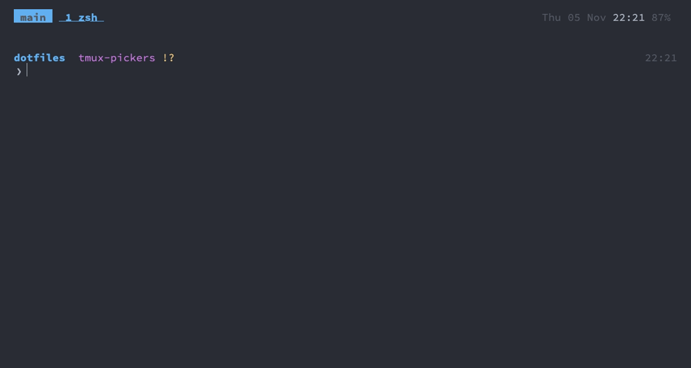

Claude Code
===

The terminal setup is built so several Claude Code agents can run side by side without getting in each
other's way, and so you notice when one of them needs you. Claude Code's own settings, instructions and
hooks are in `config/claude`, see [Config](#config).

<details>
<summary><b>Show GIF</b></summary>

`agent` starts Claude Code in a worktree and window, the window turns yellow when it needs an answer, `cmd+j`
jumps there, then merge and `agent_done`.



</details>

The GIF is recorded with the real Claude Code in a made-up project (see [gifs](gifs.md#what-it-is)), so
its words differ each time it's rendered.

What it is
---
- **One worktree per agent**: `agent` starts Claude Code in a git worktree of its own, in a tmux window of its
  own, so agents never edit the same checkout as you or each other.
- **nvim reloads files changed on disk** when you return to it, so edits made by an agent (or by git) show
  up without `:e`.
- **Agents survive closing Ghostty**: they run in tmux, and Ghostty reattaches to it. A reboot restores the
  windows (tmux-resurrect) but not the running processes.
- The tmux server is started from a login shell, so `claude` and everything it calls has the same `PATH` as
  your shell.
- **Conversations stay**: Claude Code keeps every conversation as a file in `~/.claude/projects/`, one folder
  per directory, here for a year. An agent's stays in its worktree's folder, or moves to the main checkout's
  when Claude removed the worktree itself on exit.
- **The global config**, `config/claude`, holds on any machine and in any project, with nothing about this
  Mac, its tools or this repo; what depends on the Mac comes from the `claude` wrapper ([This
  machine](#this-machine)).

### Noticing an agent that waits

Hooks tell tmux what each agent is doing (see [Hooks](#hooks)), and tmux marks it wherever it lists windows
or sessions:

| Mark | State | Set when |
|---|---|---|
| yellow bell 󰂞 | **waiting** for you | Claude asks for a permission or asks you a question |
| green tick 󰄬 | **done**, not seen yet | Claude finishes its turn in a window you're not looking at |
| cyan hourglass 󰔟 | **working** | you send a prompt or approve a permission, and after each tool it runs |
| none | idle | Claude has just started, you've looked at the finished agent, or it was on screen when it finished |

A window shows the mark of its most urgent agent, in that order; a session the most urgent of its windows. The
marks appear on the windows in the status bar, in the tree (`cmd+j`) next to every session, window and pane
with more than one in its window, and next to the running sessions in the session picker (`cmd+k`). The right
of the status bar counts the agents in each state across all sessions, e.g. `󰂞 1 󰄬 2 󰔟 3`, so you see them
from any session.

The hook also rings the bell when Claude needs input or has finished its turn, whatever the notification
setting in `/config` is: if Ghostty is in the background, the Dock icon bounces and the window title shows a
bell. Any other program that rings the bell turns its window yellow with a bell icon until you visit it.

When you aren't looking at the agent, a macOS notification tells you too: when Claude asks for a permission
(`wants to use Bash: <what the command does>`), asks you a question, or finishes its turn (the first 200
characters of its last message). The title is the conversation's title and the agent's `session:window`.
You're looking at it when its window is the active one of a session that a tmux client shows and that client's
terminal (Ghostty) is the frontmost app; then nothing is sent. Clicking the notification switches the tmux
client you used last to the agent's pane and brings Ghostty to the front. A newer notification from the same
agent replaces the older one. Outside tmux or off macOS no notification is sent.

No hook fires when you answer a permission prompt, only once the tool has finished, so while an agent waits
the hook watches its pane twice a second: when the prompt goes away and Claude's spinner line
(`✻ Thinking… (3s`) shows, you approved and it's *working*; without the spinner you declined and it's idle.

The overview of all agents (`cmd+shift+j`) lists every pane that runs Claude Code (also those started before
the hooks, which have no state yet), most urgent first: waiting, done, working, then the rest. Each line has
the agent's mark, its window and what it's working on (the title Claude gives the conversation); below is a
preview of the selected agent's screen. List and preview update within a second, so an agent that starts
waiting moves up while you look, and the cursor stays on the agent it was on; only what changed is redrawn,
so nothing flickers. For every window, agents or not, use `cmd+j` (`C-a w`).

### Status line

```
dotfiles/docs feat/claude-config !+ (worktree)  Opus 5.5 medium  ctx 18% 184k  cache 42m  $3.20  5h 12% 3h  7d 34% 4d
```

The directory from the repo root, the branch and its state with the prompt's marks (`!` modified, `+` staged,
`?` untracked, `✘` deleted, `»` renamed, `=` conflicted, `$` stashed, `⇡`/`⇣` ahead / behind), `worktree` in
an agent's own worktree, the model and effort, and how full the context window is, in percent and tokens:
green, yellow from 50%, red from 80%, when it's time to `/compact` or `/clear`. Then how much of the plan's
5-hour session and 7-day weekly limits is used, in the same colours, each followed by the time until it
resets: hours, or minutes in the last hour, for the session; days, or hours in the last day, for the week.
They appear after the first reply in a session, and not at all when signed in with an API key.

Between the context and the limits, how long the prompt cache stays warm: `cache 42m` in green, yellow in its
last 10 minutes, and `cache cold` in red once it has expired: the next message then reads the whole context
again, which is slower and uses more of the limits, so it's a good moment to `/clear` or `/compact` instead of
carrying on. The cache lasts a set time after the last request (`prompt_cache.ttl` in the input, an hour on
this setup). The status line redraws every 60 seconds (`refreshInterval` in `settings.json`), so this shows
while the session sits idle too.

After the cache, what the session would cost at API prices (`cost.total_cost_usd` in the input), in grey:
dollars and cents, whole dollars from $10. On a plan nothing is billed, but the figure grows with the usage
of the limits, so a session that gets expensive shows while it runs, not a day later in `/usage`.

ANSI colours and no icon font, so it follows the terminal's theme (here base16, like starship).

Once per project
---
Tell `agent_land` which checks to run before it merges an agent, in the project's main checkout:

```sh
git config agent.check 'checks/check_dotfiles'   # this repo
git config agent.check 'npm test'                # e.g. a Node project
```

It goes in the clone's `.git/config`, not into the project, so set it again in a new clone and on each Mac.
Pick what's fast and local, the checks you'd run before a commit.

Starting an agent
---
```sh
agent fix-login
agent fix-login "the login form rejects valid emails"
```

`agent <name> [prompt]` runs `claude -w <name>`: Claude Code in a **git worktree** of its own, on a branch
`worktree-<name>`. Inside tmux it opens in a **new window named `<name>`**, in the current directory; outside
tmux it runs right there. Arguments after the name are passed on to `claude`.

When Claude exits, the window stays open as a shell in the worktree. The worktrees live in
`.claude/worktrees/`, which the global gitignore hides from `git status` in every repo.

Reviewing an agent
---
```sh
agent_review fix-login                  # a reviewer beside fix-login, running /code-review on its branch
agent_review fix-login --model sonnet   # the same on a cheaper model; arguments go to claude
```

`agent_review <name>` starts a second Claude Code in the agent's worktree, in a pane beside the agent's own
(in a new window when the agent has none open), and goes there. It runs `/code-review` on the agent's branch,
so it reviews what's committed: `/ship` first, it says so when there are uncommitted changes. It can't use
the Edit and Write tools, so it reports and doesn't change code; tell the agent what's worth fixing, while it
still has the change in its context. Its conversation isn't one of the agent's: `agent_resume` doesn't list it.
It runs on the default model (Opus) and effort; pass `--model` or `--effort` after the name.
Fixing a pull request's CI
---
```sh
agent_ci 15607
```

`agent_ci <number>`, in a clone of the repo, or `f` on a failing pull request in the GitHub picker (`cmd+g`,
[github](github.md#keys)): an agent named `ci-<number>` that fixes the pull request's failing checks.

1. It fetches the pull request's head and makes the worktree `ci-<number>` there, on a branch
   `worktree-ci-<number>`, then starts Claude in a window as `agent` does.
2. Claude's first prompt names the failing checks, each with the `gh run view <run> --log-failed` that prints
   its log, and asks it to fix the cause and commit, not push, or to say when the failure looks flaky.
3. When it's done (green mark, notification), look at its commit and push it to the pull request:
   `git push origin HEAD:<branch>`, which Claude repeats at the end.
4. `agent_done --force ci-<number>`: squash-merged pull requests leave the commit out of the default branch, so
   it doesn't count as merged. Not `agent_land`: the fix goes to the pull request, not into the default branch.

It refuses a pull request without failing checks, one from a fork (its branch isn't on origin) and a second
`ci-<number>` while the first is still there (`agent_resume ci-<number>` goes back to it).

Finishing an agent
---
```sh
agent_land fix-login             # rebase, run the checks, merge into the default branch, then agent_done
agent_land --no-check fix-login  # the same without the checks
agent_done                       # list the repo's agents: branch, merged or not, uncommitted changes
agent_done fix-login             # remove the worktree, delete the branch, close the tmux window
agent_done --force fix-login     # the same for a branch you don't want to merge
```

1. `/ship` in the agent's window commits its work in the project's style.
2. `agent_land fix-login` merges it and finishes the agent; for a PR instead, `/ship pr`, then `agent_done
   fix-login` once it's merged.
3. `git push` when you're ready: `agent_land` never pushes.

`agent_land` does in one go what you'd do by hand, and stops at the first step that fails, saying why, with the
agent left as it was so you can ask it to fix things:

| Step | Stops when |
|---|---|
| the worktree is clean and the local default branch isn't behind origin's | there are uncommitted changes (`/ship`), or you need to pull |
| the branch is rebased onto the default branch, in the agent's worktree | it conflicts: the rebase is undone, the files are listed; ask the agent to rebase |
| the project's checks run in the worktree, on the rebased branch | they fail, or none are set (below) |
| the default branch is fast-forwarded to the branch, then `agent_done` | the main checkout's own changes are in the way |

The checks are the command in `git config agent.check`, once per clone (see [Once per
project](#once-per-project)): nothing goes into the project. It runs in your shell, so a shell function
works too. Without one `agent_land` stops; `--no-check` lands anyway. The main checkout moves along when it
has the default branch out; otherwise only the branch moves.

`agent_done` only removes things when nothing would be lost: it stops if the worktree has uncommitted
changes, and without `--force` if the branch has commits that aren't in the default branch. A commit counts as
merged when it's in the local default branch or in origin's, so an agent that pushed its work straight to
`origin/main` can be finished without pulling first. It works from anywhere in the repo, the worktree itself
included. Claude Code locks its worktree while it runs, so `agent_done` closes the window first, which ends
Claude, and waits a moment for the lock to go. Before deleting the branch it saves the agent's last commit in
`refs/agents/<name>`, and the conversation stays, so [`agent_resume`](#going-back-to-an-agent) can bring the
agent back. Tab completes the names of the repo's agent worktrees.

Going back to an agent
---
```sh
agent_resume                  # pick one of the repo's agent conversations in fzf, newest first
agent_resume fix-login        # resume fix-login's newest conversation in a new window
agent_resume 4eb428c6-…       # resume one by its session id, when an agent has several
```

`agent_resume` brings a finished agent back where it was: in its own worktree, on a branch `worktree-<name>`,
in a new tmux window named after it, like `agent`. Tab completes the names, with each conversation's title.

The picker lists each conversation's agent, when it was last active, the title Claude gave it (or the last
prompt) and its session id; the preview shows how the conversation ends. Its keys are every picker's
([tmux](tmux.md#picker-keys)): it opens in normal mode, like nvim, `j`/`k` move, `/` filters, `jj` goes back to
moving through what the filter matched, `Enter` resumes, `q` quits. Piped (`agent_resume | …`), it prints the
list instead.

When the worktree is gone, `agent_resume` makes it again at the same path, so Claude finds its conversation
there:

| What `agent_done` left | The new worktree starts from |
|---|---|
| the agent's work merged | the default branch, which holds that work |
| the work dropped with `--force` | the agent's last commit, saved in `refs/agents/<name>` |
| the branch, because the worktree was removed some other way | that branch |

`refs/agents/<name>` is a hidden ref: it keeps the commits from being cleaned up by git and doesn't show in
`git branch`. `git for-each-ref refs/agents` lists them, and `git update-ref -d refs/agents/<name>` drops one
for good. After a reboot, `claude --continue` in the agent's window picks up the last conversation instead.

Turning on a plugin
---
Where a plugin is turned on decides who gets it:

| Plugin for | Turn it on in | Reaches |
|---|---|---|
| every Mac | `config/claude/settings.json`, committed | all Macs, after `git pull` |
| this Mac only (e.g. work plugins on the work Mac) | `~/.config/dotfiles/claude.json` | only this Mac, all projects |
| one project, for you | the project's `.claude/settings.local.json` (`/plugin` → scope *local*) | only you, ignored by git everywhere |
| one project, for the whole team | the project's `.claude/settings.json` (scope *project*) | everyone working on it |

On every Mac: `frontend-design` from the official marketplace, design guidance when building a UI.

A plugin turned on in `claude.json` needs its marketplace there too:

```json
{
  "extraKnownMarketplaces": {
    "my-company": { "source": { "source": "github", "repo": "my-company/claude-plugins" } }
  },
  "enabledPlugins": { "some-plugin@my-company": true }
}
```

To keep a plugin from `claude.json` out of one project, set it to `false` in that project's
`.claude/settings.local.json` (`"enabledPlugins": { "some-plugin@my-company": false }`) and restart
Claude Code. Plugins shared with your claude.ai organisation sync by themselves and touch no file.

Adding a skill
---
1. Write `config/claude/skills/<name>/SKILL.md`.
2. Start a new `claude`: the wrapper links it into `~/.claude/skills` (a session that is already running may
   need a restart).
3. Add it to the table in [Skills](#skills) and commit.

Checking token usage
---
`claude_tokens [days]` shows what Claude Code used in the last few days (default 7), from the conversations in
`~/.claude/projects`, subagents included: per model, per project (the directory the session started in) and
the five costliest sessions, each with its requests, fresh input, cache writes, cache reads, output and the
cost at API prices. The dollars put every model and cache read on one scale, so they answer where the usage
goes and whether a change (Haiku subagents) cut it, which `/usage` only shows as
shares. A `+` after a cost means some requests were on a model the function has no price for (an older one);
`?`, that all were. A session id goes straight into `claude -r <id>`. It reads a week (~3,000 requests) in
under a second.

Keys
---
| Key | Action |
|---|---|
| `shift+enter` | newline in Claude Code's prompt instead of sending it |
| `jj` / `Esc` | normal mode in the prompt, then motions like `w`, `b`, `f`, `dd`, `ciw`; `i` back to typing ([vim-keys](vim-keys.md)) |
| `shift+tab` | auto mode, see [Permissions](#permissions) |
| `cmd+shift+j` (`C-a a`) | the overview of all agents: `j` / `k` down / up, `g` / `G` the first / last agent, `ctrl+d` / `ctrl+u` half a page, `/` filters, `Enter` jumps there, `q` or `Esc` closes it ([picker keys](tmux.md#picker-keys)) |
| `cmd+shift+space` (`C-a A`) | the next agent that needs you, in any session: waiting ones first, then done ones (which turn idle as you see them); again for the one after; says so when none is left |
| `cmd+shift+0` / `cmd+0` | back to the session / window you came from |

Commands
---
| Command | Does |
|---|---|
| `agent <name> [prompt]` | Claude Code in a worktree and window of its own ([Starting an agent](#starting-an-agent)) |
| `agent_review <name> [claude args]` | a read-only reviewer beside the agent, running `/code-review` on its branch ([Reviewing an agent](#reviewing-an-agent)) |
| `agent_land [--no-check] <name>` | rebase, check, merge into the default branch and finish the agent ([Finishing an agent](#finishing-an-agent)) |
| `agent_ci <number>` | an agent that fixes pull request `<number>`'s failing checks ([Fixing a pull request's CI](#fixing-a-pull-requests-ci)) |
| `agent_done [--force] [name]` | list the agents, or finish one ([Finishing an agent](#finishing-an-agent)) |
| `agent_resume [name \| id]` | pick or resume an agent's conversation ([Going back to an agent](#going-back-to-an-agent)) |
| `claude_tokens [days]` | token usage and cost ([Checking token usage](#checking-token-usage)) |
| `/hooks` | list the hooks |
| `/sandbox` | the sandbox settings in effect |
| `/resume` | bring back a cleared conversation, which is still on disk |

### Skills

Slash commands from `config/claude/skills` ([Config](#config)):

| Command | Does |
|---|---|
| `/ship [pr] [about]` | finishes the work in this checkout: moves to a branch if on the default one, checks the diff against the project's `CLAUDE.md` (docs, lock files, tests that should come with it), runs the project's checks, commits in the project's style. With `pr` it also pushes and opens a pull request. Only you can start it; Claude doesn't run it by itself |
| `/handoff [focus]` | gets a conversation ready for `/clear`: saves what only it knows (open items, the next step, ideas not taken, options you declined, gotchas, the state of the branch) into Claude's memory, updating the file that already covers a topic, lists each item with the file it went into so you can check it, and ends with one line to paste after `/clear` to carry on. It writes memory only, never commits. Only you can start it |

Config
---
`config/claude` is the **global** part. `setup_claude` links it into `~/.claude`:

- **`settings.json`**: model (Opus) and effort, permissions, sandbox, hooks, voice dictation (hold space),
  vim keys in the prompt (`editorMode`, `vimInsertModeRemaps`). Commits made by Claude carry only the
  `Co-Authored-By` trailer, no session link (`attribution.sessionUrl`). Conversations are kept for a year
  (`cleanupPeriodDays`). Subagents run on Haiku (`CLAUDE_CODE_SUBAGENT_MODEL`) unless Claude gives one a model
  when it starts it; `CLAUDE_CODE_SUBAGENT_MODEL_FORCE` is left off. The status line redraws every 60 seconds
  (`refreshInterval`).
- **`CLAUDE.md`**: instructions for every project: delete to the trash, work on a branch, merge and push only
  when asked; before you `/clear`, list what would be lost with the context and where it gets saved; pick a
  model per subagent (Haiku for searching and reading, Sonnet or Opus for judgment) and suggest another model
  for the conversation when one fits better. What a project or machine needs goes in that project's own
  `CLAUDE.md` (this repo's names the Mac it sets up).
- **`hooks/`**: the scripts the [hooks](#hooks) run.
- **`skills/`**: the [skills](#skills) every project gets. `setup_claude` links each one into
  `~/.claude/skills`, which stays a real directory because the skills claude.ai syncs live there too; the
  `claude` wrapper does the same each time it starts, so a new skill is there from the next `claude` on and a
  deleted one goes away.
- **`statusline.sh`**: the [status line](#status-line).

Settings you change with `/config` or by installing a plugin are written through the link into the repo, so
they show up in `git diff`.

### Permissions

- **Allowed without asking**: read-only `git` (`status`, `diff`, `log`, `show`, `blame`, `worktree list`),
  read-only `gh pr` / `gh issue` / `gh run`. Claude Code already lets plain reads like `ls`, `cat` or `rg`
  through by itself.
- **Never allowed**: force pushes (`--force-with-lease` still asks) and reading private key files
  `~/.ssh/id_*`. In this repo also `zsh/.private` and `config/nvim/lua/user/hidden/`, which hold secrets
  (`.claude/settings.json`, this repo's own project settings).
- **Google Cloud is read-only**: `gcloud`, `bq` and `gsutil` commands that create, change or delete
  resources or access, and `gcloud config set`, are denied (see [gcloud](gcloud.md#what-claude-code-can-do)).
- **AWS is read-only**: `aws` commands that create, change or delete resources or access, `aws configure
  set`, and `cdk deploy` / `destroy` / … are denied, and so is reading `~/.aws/credentials` and the SSO and
  CLI caches (see [aws](aws.md#what-claude-code-can-do)).
- Everything else asks as usual, including `git commit` and `git push`, outside auto mode.
- **In auto mode** (`shift+tab`) Claude doesn't ask before a command its classifier judges safe for the task,
  and that includes `git commit`. The global `CLAUDE.md` still says to commit only when asked; push, force
  push and the deny list above hold in auto mode too.

### Sandbox

Every command Claude runs in Bash runs in Claude Code's sandbox (macOS Seatbelt), set in `settings.json`
under `sandbox`. Inside it, commands run without asking (`autoAllowBashIfSandboxed`), because they can only:

- **write** in the project, the temp directory, `~/.cache` and `~/.local/state` (shell and nvim state). Not
  even there: Claude Code's own settings, hooks and `CLAUDE.md`, so Claude edits those with its Edit tool,
  which asks.
- **read** everywhere except the files the permissions deny (`~/.ssh/id_*`, AWS credentials and caches, this
  repo's secrets).
- **reach** GitHub, Homebrew's API, npm and PyPI without asking, any port on localhost (dev servers), and
  Secretive's socket (see [This machine](#this-machine)); a host not listed asks.

| Runs outside the sandbox | Why |
|---|---|
| `trash`, `gio trash` | moves to the Trash, outside the project: the way `CLAUDE.md` says to delete |
| `git push / pull / fetch` | SSH to GitHub can't go through the sandbox's proxy |
| `gh`, `gcloud`, `bq`, `gsutil`, `kubectl` | Go programs whose TLS checks fail under Seatbelt |
| `aws` | needs the SSO token in `~/.aws/sso/cache`, which the sandbox can't read ([aws](aws.md#to-look-out-for)) |
| `brew` | writes to `/opt/homebrew` |
| `tmux` | needs its socket: `tmux -L probe` and the hooks' window state |
| `check_dotfiles`, `check_mac`, `checks/*` | in this repo only (`.claude/settings.json`): the tmux checks need a socket |

These still go through the permission rules. A command the sandbox stops fails with "Operation not
permitted"; Claude may then run it again outside, which asks first (in auto mode the classifier decides).

### This machine

The parts that depend on the Mac live in the dotfiles, not in `config/claude`. The `claude` shell function
(`zsh/functions/claude.zsh`) starts Claude Code with `--settings` on top of the shared settings:

- **Signing in the sandbox**: the socket in `SSH_AUTH_SOCK` (Secretive's, from `zsh/.exports`) is allowed,
  so sandboxed commands can sign commits. Pushing still asks for Touch ID.
- **This Mac's settings**: `~/.config/dotfiles/claude.json` (from `setup_machine`, `{}` at first), merged
  in. Anything a settings file can hold: plugins and marketplaces, `env`, permissions, a different `model`,
  and auto mode's description of the environment (`autoMode.environment`), which names this Mac's repos.
- **The project's plugin choices**: `enabledPlugins` from the project's `.claude/settings.local.json`, put on
  top. Settings passed with `--settings` outrank that file, so without this a project couldn't switch off a
  plugin that `claude.json` turns on.
- **New skills**: before it starts, it links any skill added to `config/claude/skills` and drops the links of
  deleted ones (see [Skills](#skills)).

### Work projects

The global config is meant to sit unnoticed next to a team's own Claude Code setup:

- A project's `.claude/settings.json` and `CLAUDE.md` add to these settings or override them; nothing here
  writes into a project. Personal project settings go in `.claude/settings.local.json`, which the global
  gitignore keeps out of every repo, as it does agent worktrees.
- The format hook formats only with what the project itself configures (see [Hooks](#hooks)), so files
  aren't restyled in someone else's style.
- **Settings managed by the company**: if IT installs Claude Code settings through MDM
  (`/Library/Application Support/ClaudeCode/managed-settings.json`), they take precedence over everything
  here, including the `claude` function's. Plugins they turn on simply join the others. If they allow only
  managed hooks or permission rules, the hooks and permissions here stop applying; nothing else changes.

### Hooks

| When | Does |
|---|---|
| before a shell command | refuses deletes that can't be undone (`rm -r` / `rm -rf`, `find … -delete`, `git clean -f`) and tells Claude to move things to the trash instead (`git stash -u` for untracked files) |
| after Claude edits or writes a file | formats it with the language's formatter, if installed and the project uses it: prettier, stylua and ruff only where the project has their config, `shfmt` where it has an `.editorconfig`, `goimports`/`gofmt` always (Go has one style) |
| Claude needs input, or has finished | rings the bell in its tmux pane: here the window turns yellow and Ghostty bounces in the Dock; does nothing outside tmux |
| Claude asks for permission or a question, or has finished | sends a macOS notification unless you're looking at the agent's tmux window; clicking it jumps there ([Noticing an agent that waits](#noticing-an-agent-that-waits)); does nothing outside tmux or off macOS |
| the session starts, a prompt is sent, a tool has run, Claude asks for permission or a question or has finished, the session ends | records the agent's state (working, waiting, done) in its tmux pane, for the marks in [Noticing an agent that waits](#noticing-an-agent-that-waits); does nothing outside tmux |

The scripts need zsh and jq; a formatter, tmux or terminal-notifier that isn't there is skipped.
`"disableAllHooks": true` in `settings.json` turns them all off. The agents overview is `config/tmux/agents`,
the jump to the next agent `config/tmux/next-agent`.

To look out for
---
- If `ls -l ~/.claude/settings.json` ever shows a plain file instead of a link, copy the changes into
  `config/claude/settings.json` and run `setup_claude` again.
- `/plugin install` with the default scope (*user*) writes into the shared `settings.json`. When a session
  ends, the `claude` function checks for that and says so; move the entries to `claude.json`, or commit them
  if every Mac should have them.
- Plugins your organisation turns on through managed settings can't be switched off per project; managed
  settings outrank everything.
- Claude Code started some other way, from the desktop app or an IDE, gets none of the wrapper's settings
  ([This machine](#this-machine)).
- **Notifications** need `terminal-notifier` (Brewfile). Without it, or with its notifications turned off,
  `osascript` shows a plain notification that clicking doesn't jump from. The first notification asks whether
  terminal-notifier may send notifications; if it was declined, turn it on in System Settings → Notifications
  → terminal-notifier, or run `tccutil reset UserNotification fr.julienxx.oss.terminal-notifier` to be asked
  again. `terminal-notifier -diagnose` says what's wrong when none appear.
- **The approval watcher reads Claude Code's screen**: if a release changes the prompt's `Esc to cancel` or
  the spinner line, it gives up after 10 s and the window shows *working* only once the tool is done.
- **Sandbox**: only a whole command line is excluded: `tmux …; checks/check_dotfiles` or
  `checks/check_dotfiles | tail` runs sandboxed, so run excluded commands on their own. Run that way, the two
  tmux checks are skipped and say why, instead of failing.
- **Sandbox**: Claude's shell is a snapshot of an interactive zsh, which keeps the functions but only exported
  variables; so `.zshrc` exports `real_script_dir` (the repo), which the functions use.
- **Sandbox**: no unix socket can be made inside: zsh skips lowering background jobs' priority when
  `$CLAUDECODE` is set (`bg_nice`, `zsh/.zshdefault`), git's fsmonitor is off for Claude's commands (`env` in
  `settings.json`), and nvim's fzf-lua falls back to a localhost port (`user/fzf-lua/server.lua`).
- **Sandbox**: `open`, `osascript` and `pbcopy` don't work inside; Claude gives you the command, or `/copy`
  for text.
- **Sandbox**: a change to the sandbox settings applies to the next command, a new exclusion in a project's
  `.claude/settings.json` only after a restart.
- **`agent_review` reads only what Claude Code's tools let it**: the Edit and Write tools are taken away, but
  a Bash command could still write; in auto mode the classifier and the sandbox stop most of that, not all.
- **A reviewer's conversation** is told apart by its first prompt, `/code-review`: one you start by hand with
  that prompt in an agent's worktree is left out of `agent_resume` too.
- **`agent_land` rebases the agent's branch under it**: when the agent is still working, let it finish its
  turn first, or its next edit lands on the rebased files.
- `claude_tokens`' prices are in the function (from the `claude-api` skill, 2026-10); they matched Claude
  Code's own cost for a session to the cent. Requests Claude Code makes outside the conversation, like titles,
  aren't in the files and aren't counted.

Decisions
---
- **Opus without `[1m]`**: it has a 1M-token context of its own.
- **Subagents on Haiku**: in `/usage`, subagents on the main model were 40% of the usage.
  `CLAUDE_CODE_SUBAGENT_MODEL_FORCE` stays off, so Claude can still choose a bigger one.
- **Conversations kept a year, not 30 days**, so `agent_resume` and `claude -r` can still find old ones.
- **`git commit` isn't blocked in auto mode**: a commit on a branch is easy to undo (`git reset HEAD~`).
- **Hooks for the agents' state**: inside tmux, Claude Code keeps its terminal title still (`✳`, no spinner)
  and sends no progress bar, so neither can show the state.
- **Reading the screen for approvals**, like [herdr](https://github.com/herdrdev/herdr) does: no hook fires
  when you answer a permission prompt.
