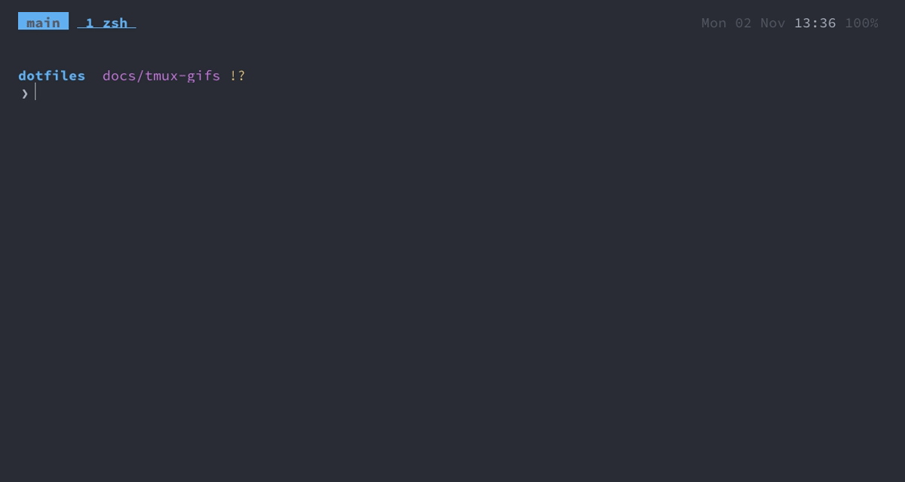

fzf and friends
===

fzf is the fuzzy finder behind most "pick something" moments in the shell: files, directories,
completions, tmux sessions, colour schemes. A few small tools feed it or show its previews.

| Tool | Role |
|---|---|
| [fzf](https://github.com/junegunn/fzf) | the finder |
| [fd](https://github.com/sharkdp/fd) | lists files and directories for fzf: fast, respects `.gitignore`, includes dotfiles |
| [bat](https://github.com/sharkdp/bat) | file previews with syntax highlighting |
| [eza](https://github.com/eza-community/eza) | directory previews as a tree |
| [ripgrep](https://github.com/BurntSushi/ripgrep) | content search (`fif`, nvim) |
| [glow](https://github.com/charmbracelet/glow) | renders markdown in the terminal for `mdv` |
| [fzf-tab](https://github.com/Aloxaf/fzf-tab) | zsh's `Tab` completion menu replaced by fzf |

Config: `.fzf.zsh` (linked to `~/.fzf.zsh`), loaded by zsh after `bindkey -v`, which would otherwise reset its key bindings.

Shell keys
---

<b>Show GIF</b>

`C-t` puts a picked file on the command line, `**<Tab>` completes a directory.

| Key | Action |
|---|---|
| `C-r` | search [atuin's history](zsh.md#history), put the chosen command on the command line |
| `C-t` | pick files (several with `Tab`) and insert their paths |
| `Alt+C` (also `Option+C` → `ç`) | `cd` into a subdirectory |
| `**<Tab>` | fzf completion after a command, e.g. `vim **<Tab>`, `cd **<Tab>`, `kill **<Tab>` |

Inside any fzf list
---
| Key | Action |
|---|---|
| `Tab` / `Shift+Tab` | mark / unmark (multi-select is on everywhere) |
| `C-a` | mark all |
| `?` | show / hide the preview (hidden by default) |
| `C-n` / `C-p` | scroll the preview a line; `C-Alt+n` / `C-Alt+p` half a page |
| `C-y` | copy the marked entries to the clipboard |
| `C-j` / `C-k` or arrows | move |

fzf takes 60 % of the screen below the command line instead of going full screen, with its prompt and best
matches at the top. The prompt, the list and the preview each sit in a rounded box of their own, all the same
width; a bar marks the current line only.
Previews show files with bat and directories as an eza tree. Colours are ANSI ones and follow the
[theme](theme.md).

Search syntax worth remembering: `'exact`, `^prefix`, `suffix$`, `!exclude`, and `a | b` for either.

Completion (fzf-tab)
---
Every `Tab` completion opens in fzf instead of zsh's menu, looking like every other fzf: type to filter,
`Enter` to accept.

- Completions are grouped (commands, aliases, files, …); `,` and `.` switch groups.
- `cd <Tab>` previews each directory's contents.
- Files are coloured like `ls`.
- `git checkout <Tab>` keeps git's own order (recent branches first) instead of sorting.

Markdown (mdv)
---
`mdv [dir]` picks a markdown file under `dir` (default: the current directory) with fzf and opens it rendered
in glow's pager. The preview pane shows the rendered file as you move through the list, wrapped to the pane's
width. Only one file can be picked, and `q` leaves the pager. `mdv <file>` skips the list and opens that file.
glow renders with `config/glow/ansi.json`, a style in the terminal's 16 colours, so it follows the
[theme](theme.md): headings blue, inline code red, links cyan, quotes grey. Code blocks are plain: glow's
highlighter only takes fixed colours.

`mds [dir]` shows the same files in the browser instead: a local site with the folders as a sidebar, search,
and a reload whenever a file is saved (MkDocs with the Material theme, through `uvx`, on `127.0.0.1:8000`, or
`MDS_PORT`). Nothing is installed or written into the folder, and nothing leaves the Mac; a folder with its
own `mkdocs.yml` is served with that. `C-c` stops it.

Find in files
---
`fif <text>` lists the files containing the text; the preview shows the matches with context. For the
same in nvim, use `;r` (live grep), see [neovim](neovim.md#finding-things).
