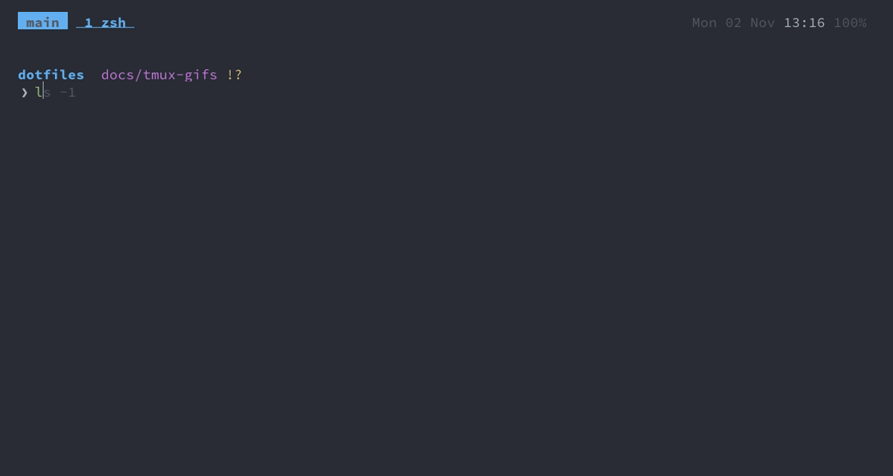

GIFs
===

The animations in these docs show what a key does. They're recorded from scripts, not by hand, so they can
be made again whenever a binding or the colour scheme changes.

| GIF | In | Shows |
|---|---|---|
| `tmux-panes` | [tmux](tmux.md#keys) | splitting, moving between and zooming panes, a new window |
| `tmux-sessions` | [tmux](tmux.md#session-picker) | the session picker, the session tree, switching sessions |
| `zsh-history` | [zsh](zsh.md#history) | prefix search with the up arrow, grey suggestions, atuin |
| `fzf` | [fzf](fzf.md#shell-keys) | `C-t` and `**<Tab>` |
| `nvim` | [neovim](neovim.md#keys) | finding a file, the file tree, crossing between nvim and tmux |
| `git` | [git](git.md#lazygit) | delta, difftastic, staging and committing in lazygit |
| `claude-code` | [claude-code](claude-code.md) | `agent` in a worktree and window, the yellow bell, `cmd+j`, `agent_done` |

How they're made
---
- Each GIF has a [VHS](https://github.com/charmbracelet/vhs) tape in `docs/tapes/<name>.tape`: the keys to
  press and how long to wait, e.g. `Ctrl+a Type "|" Sleep 1.2s`. The GIF goes to `docs/img/<name>.gif`.
- `make_gifs` (`zsh/.functions`) renders them: all tapes, or the ones named (`make_gifs tmux-panes`). It
  adds the Ghostty font and colour scheme to each tape, so the GIFs match the terminal and follow
  `change_theme`.
- Each tape runs in a made-up HOME that `docs/tapes/demo-home` builds: the repo's config linked as the setup
  links it, nvim's installed plugins, and invented shell history, zoxide directories and projects (a small
  git repo in `~/repos/api`). So no real command, path or project shows up in a GIF, and nothing from
  `~/.config/dotfiles` either: the GIFs show the shared setup. tmux runs as a separate server (`tmux -L
  demo`, with `docs/tapes/demo.tmux.conf`), so your sessions aren't touched; resurrect and continuum don't
  load. Every tape gets a fresh HOME, so one tape's commands don't turn up in the next.
- `claude` in that HOME is the real Claude Code, logged in with the Mac's Keychain entry. Its
  `~/.claude.json` there has the account's IDs and plan but not its name, email or organisation, so those
  can't appear in a GIF. Rendering `claude-code` is a real (small) session on your plan, and Claude's words
  differ each time; the tape waits for what's on screen and hides the waiting.
- `docs/tapes/keycast` sits between the terminal and tmux and shows each key pressed as a yellow badge on a
  second status line:
  - a prefix chord that a Ghostty `cmd` key sends shows as that key, the one you'd press: the tape types
    `C-a |`, the badge says `cmd+d`. It reads the keybinds from `config/ghostty/config`, so it stays right
    when they change. Chords without a Ghostty key show as `C-a l`;
  - keys like `C-h`, `C-r`, `Enter`, `Tab` and the arrows show as they are;
  - in nvim and lazygit, where letters are commands, letters typed in one go share a badge: `;f`, `,e`;
  - plain typing in the shell shows no badge, since the text appears in the pane anyway.

  It's Python because it needs a pseudo-terminal in the middle of the input.
- VHS can't press `cmd` (it records a terminal in a browser, not Ghostty), so tapes type the tmux keys
  Ghostty would send: `Ctrl+a Type "|"` for `cmd+d`. A comment above each says which `cmd` key it is.

Adding one
---
1. Write `docs/tapes/<name>.tape`, starting with `Output docs/img/<name>.gif`. The tape starts inside tmux,
   in the session `main`, in `~/dotfiles` (the repo). See the
   [VHS commands](https://github.com/charmbracelet/vhs#vhs-command-reference).
2. `make_gifs <name>` and look at the result. If the GIF needs more made-up data, add it to `demo-home`.
3. Embed it next to the keys it shows, ``, and add it to the table above.

Keep them short (around 15 s) and under ~1 MB, since every version stays in git.

Needs `vhs` (which brings `ttyd` and `ffmpeg`) and the Symbols Nerd Font for the icons, both in the Brewfile.
