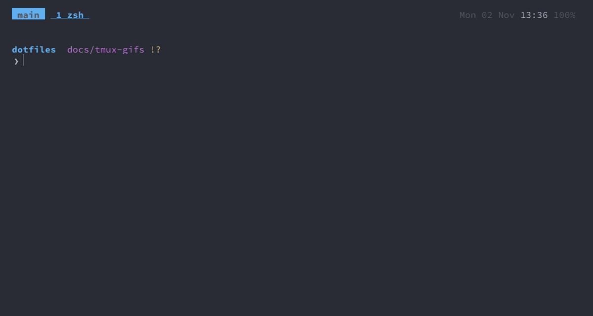

git
===

Plain git with current defaults, delta and difftastic for diffs, signed commits, a few aliases, fugitive in nvim
for staging, committing and reviewing, and SSH keys that live in the Secure Enclave (Secretive).

What it is
---
- **Diffs, logs and `git add -p`** go through [delta](https://github.com/dandavison/delta): syntax context
  lines syntax-highlighted, removed lines red and added ones green, the changed words within them on a red /
  green background, line numbers, moved lines in their own colour. All in the terminal's 16 colours, so diffs
  follow the [theme](theme.md). `n` / `N` jump between files.
- **Structural diffs** with [difftastic](https://difftastic.wilfred.me.uk): `git dft`, `git dlog`,
  `git dshow` compare syntax trees, so reformatting and re-wrapping don't show up as changes.
- **Better hunks and conflicts**: the histogram diff algorithm; conflict markers show the common ancestor
  too (`zdiff3`); `rerere` remembers how a conflict was resolved and replays it.
- **Signed commits and tags** with your SSH key, see [Signing](#signing).
- **Typos**: `git stauts` suggests `git status` and asks before running it.
- **Renames and copies** are detected in diffs.
- **`git pull` rebases** your local commits onto the fetched ones, so it never makes a merge commit;
  `git merge` commits list the merged commits. `git fetch` drops branches deleted on the remote. `git push`
  on a new branch creates and tracks it on origin.
- **Rebases** stash and restore uncommitted changes and move stacked branches along (`updateRefs`).
- **`git status` stays fast** in big repos: git's file-system monitor runs per repo, untracked files are
  cached.
- **`git branch`** lists recently used branches first. New repos start on `main`.
- **Ignored in every repo**: `.DS_Store`, Claude Code's agent worktrees (`.claude/worktrees/`) and personal
  `.claude/settings.local.json`, and the files xcodebuild.nvim writes into iOS projects (`.nvim/xcodebuild/`,
  `buildServer.json`, see [mobile](mobile.md)).
- **Editor** is nvim and shows the diff below the commit message; `git difftool` and `git mergetool` open
  nvim's diff mode.
- **In nvim**: changed lines are marked in the sign column (gitsigns), `,gb` shows blame and `,go` opens the
  file on GitHub; `;g` lists the branch's changed files for a review. See [neovim](neovim.md#git).

### Identity

`[user]` is the same on every Mac. What differs per Mac goes in `~/.config/dotfiles/gitconfig`, which
`~/.gitconfig` includes last (`setup_machine` creates it from `config/machine/gitconfig`, see
[setup](setup.md#several-macs)). On a work Mac that is the work email, only in work repos (see [Using a work
email](#using-a-work-email)). Each Mac signs with its own Secretive key; GitHub verifies a work commit when
the key is on the account that has the work email.

### Staging and committing

`gs` in a shell, `,gs` inside nvim: [fugitive](https://github.com/tpope/vim-fugitive)'s status, an nvim
buffer listing what's untracked, unstaged, staged and not pushed. It opens on the `Head:` line: `gu` goes to
the first untracked or unstaged file, `gs` to the first staged one. `s` / `u` stage and unstage the file under
the cursor; `=` opens its diff inline, where `s` on a hunk or on lines selected with `V` stages just those.
`cc` writes the commit message in a buffer of the same nvim (`:wq` commits, `:q` without saving doesn't),
`ca` amends, `dv` opens the file's diff side by side. `g?` lists every key; any other git command is `:Git
<command>`, its output in a buffer. Interactive rebases (`git rebase -i`) open nvim on the todo list:
reorder lines with `dd` / `p`, change `pick` to `fixup` with `cw`.

<details>
<summary><b>Show GIF</b></summary>

`git diff` through delta, `git dft` through difftastic, then staging and committing in fugitive (`gs`).



</details>

### Signing

Commits and tags are signed with the SSH key in `user.signingkey` (`gpg.format = ssh`); no GPG needed. Each
Mac signs with its own key: `secretive_key signing` sets the key and turns signing on in the Mac's
`~/.config/dotfiles/gitconfig`. `ssh-keygen` signs through the agent in `SSH_AUTH_SOCK`, which `zsh/.exports`
points at Secretive's. The signing key is a Secretive key that doesn't ask for Touch ID, so commits, rebases
and amends never prompt.

- **GitHub** shows the commits as *Verified* once the public key is added as a **signing** key:
  `secretive_key signing` does that (see [SSH keys](#ssh-keys)).
- **Locally**, `git log --show-signature` checks signatures against `config/git/allowed_signers`. Each line
  ends with the name of the Mac the key belongs to. A retired key keeps its line with
  `valid-before="<time>"`, so the commits it signed before then still verify and nothing signed with it later
  does; the RSA and ed25519 key files used before Secretive are kept that way.

### One set of keys per Mac

Every Mac makes its own keys, and they never leave it: not into git, a backup, a password manager or another
Mac. A new Mac gets new keys; a Mac that goes away takes its keys with it, and they are revoked. So a lost or
stolen Mac costs one Mac's keys, which you revoke from any other, and every key on GitHub and in
`config/git/allowed_signers` carries the name of the Mac it belongs to.

| What | Where it lives | On a new Mac |
|---|---|---|
| SSH keys for pushing and signing | Secretive, in the Mac's Secure Enclave (can't be exported) | made fresh: `secretive_key push`, `secretive_key signing` |
| GitHub CLI token | the Keychain | `gh auth login` |
| Other logins (cloud CLIs, registries) | each tool's own login, per Mac | log in again |
| Secrets that exist only once (a vendor's API key, recovery codes) | the password manager | copy into `zsh/.private` when a Mac needs it |

Prefer a token per Mac wherever a service offers one, so it can be revoked on its own; only what can't be
made twice goes in the password manager.

### SSH keys

The keys are made by [Secretive](https://github.com/maxgoedjen/secretive) in the Mac's Secure Enclave. The
private halves can't be read or copied, not even by malware running as you; a key can only be *used*, through
Secretive's agent, which shows a notification each time. There are two:

| Key | Touch ID | Used for |
|---|---|---|
| `push` | on every use | ssh to GitHub and GitLab: push, pull, fetch, clone |
| `signing` | never | signing commits and tags |

So only connections to a server prompt; signing, which happens on every commit, doesn't. A stolen session can
still sign while you're logged in, but can't push without your finger.

`config/ssh/config`, included at the top of `~/.ssh/config`, sends every host to Secretive's agent
(`IdentityAgent`) and gives GitHub and GitLab only the push key.

Once per Mac
---
Part of [A new Mac](setup.md#a-new-mac), step 4:

1. In the Secretive app, create a key named `push` with *Require Authentication* on, and one named `signing`
   with it off.
2. `secretive_key push` and `secretive_key signing`: each copies the public key to
   `~/.ssh/identities/secretive/<role>.pub` (which the ssh and git config point to) and adds it to GitHub under
   the Mac's name from `setup_machine`, the push key for ssh and the signing key for signing (and to
   `config/git/allowed_signers`, with the Mac's name). For GitLab, `secretive_key push` copies the public key
   and opens the page to paste it. Named them differently? `secretive_key push "GitHub push"`.
3. Commit `allowed_signers`.
4. `gh auth login` for the GitHub CLI.
5. To quiet Secretive's notifications: System Settings → Notifications → Secret Agent, alert style *None*:
   each use is still listed in Notification Centre, without a banner. Turning *Allow notifications* off hides
   them completely.

`setup_ssh` (part of `setup_dotfiles`) adds the include line, removes the `com.makst.ssh-add` login item
(which loaded keychain keys into macOS's own agent before Secretive) and the `ssh`/`scp`/`sftp` links to
ssh-ident, which earlier versions of this repo used.

Using a work email
---
In `~/.config/dotfiles/gitconfig` on the work Mac:

```ini
[includeIf "hasconfig:remote.*.url:git@github.com:my-company/**"]   # by remote, in any folder
	path = ~/.config/dotfiles/gitconfig-work
[includeIf "gitdir:~/work/"]                                        # or by folder
	path = ~/.config/dotfiles/gitconfig-work
```

with `[user] email = me@example.com` in `gitconfig-work`. `git config user.email` inside a repo shows
which one applies.

Retiring a Mac
---
`retire_mac <name>` on another Mac revokes the keys of one that is sold, wiped, handed back or lost; the steps,
including what it can't do for you, are in [setup](setup.md#retiring-a-mac).

Turning signing off in a repo
---
`git config commit.gpgsign false` inside it.

Commands
---
### Aliases and functions

| Command | Does |
|---|---|
| `git go <branch>` | switch to the branch, creating it if needed |
| `gsw [branch]` | the same with a name; without one, pick a branch (local or remote, newest first) in fzf, its log as the preview (`zsh/functions/git.zsh`) |
| `gs` | git status in nvim (fugitive), alone in the window: [Staging and committing](#staging-and-committing) |
| `greview` | the branch's changed files in nvim's `;g` picker, to review ([neovim](neovim.md#reviewing-a-branch)) |
| `gfix` | commit what's staged as `--fixup` of a commit picked from the branch's own, `git show` as the preview; `git rebase -i --autosquash` folds it in |
| `git dft`, `git dlog`, `git dshow` | `diff`, `log -p`, `show` through difftastic |
| `git get <branch>` | check out `origin/<branch>` as a tracking branch |
| `git lca` | log with hash, date, committer and author on one line each |
| `git aliases` | list all aliases |
| `secretive_key push \| signing` | publish this Mac's key, see [Once per Mac](#once-per-mac) |
| `retire_mac <name>` | revoke a Mac's keys, see [Retiring a Mac](#retiring-a-mac) |
| `mac_keys` | which keys belong to which Mac |

### Other commands

| Command | Does |
|---|---|
| `ssh-add -l` | the keys Secretive offers |
| `ssh -T git@github.com` | check the push key |

Config
---
| File | Contains |
|---|---|
| `config/git/.gitconfig` (linked to `~/.gitconfig`) | everything shared; **change `[user]` in your fork**: it holds the GitHub noreply address, so commits don't expose a private email |
| `~/.config/dotfiles/gitconfig` | outside the repo, included last: what only this Mac needs (signing key, work email) |
| `config/git/ignore` (linked to `~/.config/git/ignore`) | ignored in every repo |
| `config/git/allowed_signers` | every Mac's signing key, for `git log --show-signature` |
| `config/ssh/config` | included at the top of `~/.ssh/config`: Secretive's agent, the push key for GitHub and GitLab |
| `config/nvim/lua/user/git/` | fugitive's keys and the `;g` review picker ([neovim](neovim.md#git)) |

To look out for
---
- Commits to this repo keep the shared email on every Mac: `check_dotfiles` fails while a commit not yet
  pushed has another one, as author or committer (see [setup](setup.md#checks)).
- A Mac without a signing key yet commits unsigned instead of failing.
- With signed commits, Secretive's notifications come often; it has no setting for them (see step 5 of [Once
  per Mac](#once-per-mac)).
- delta's red and green backgrounds are fixed shades, not theme colours.
- Private hosts go in `~/.ssh/config` below the include; one that still uses a key file reads its passphrase
  from the keychain (`UseKeychain`, after `ssh-add --apple-use-keychain <key>` once).

Decisions
---
- **fugitive, not lazygit**: one place for git, inside nvim, with vim's keys in every list; see
  [neovim](neovim.md#decisions).
- **Secretive keys, not key files**: the private halves can't be copied. The price: no backups, so a new Mac
  means new keys, and they are ECDSA P-256 (the only kind the Secure Enclave makes), which GitHub and GitLab
  accept like ed25519.
- **Two keys, Touch ID only for pushing**: signing happens on every commit and would prompt all the time.
- **SSH signing, not GPG**: the same Secretive agent signs, with no GPG to set up.
- **No credential helper for `https://git@github.com`**: tpm and lazy.nvim clone plugins as the user `git`
  with no password, so they never prompt; git would save that empty login in the macOS keychain after each
  clone, or show "A keychain cannot be found to store git" where there's no keychain.
