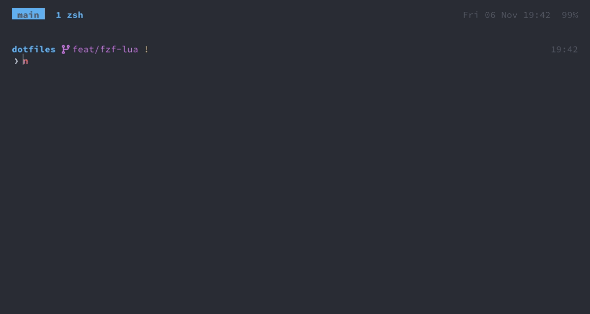

Neovim
===

Neovim from Homebrew, configured in Lua, with LSP, treesitter, telescope and a set of plugins for moving
around quickly. `vim` runs nvim everywhere (a link in `~/bin`), including as git's editor.

Config: `config/nvim/` (linked to `~/.config/nvim`). Reload most of it in place with `,re`; plugin changes
need a restart.

Layout of the config
---
- `init.lua` loads everything in order: options, keymaps, then one module per plugin.
- `lua/user/base.lua` options, `lua/user/keymaps.lua` general keys, `lua/user/plugins.lua` the plugin list.
- `lua/user/<plugin>/` per plugin: `config.lua` (setup) and `keymaps.lua`; the same for nvim's own tools
  (`android/`, `vscode/`). Every key is bound in a `keymaps.lua` (a check fails on one bound anywhere else),
  so to find a key, look in the `keymaps.lua` of the plugin it belongs to. That includes keys a plugin only
  takes from its setup, like nvim-tree's buffer keys: `keymaps.lua` exports them and `config.lua` passes
  them on. The one exception is a telescope picker's own actions (codetour's `dd`, `r`), which telescope
  takes inside the picker's definition (`codetour/telescope.lua`).
- Every key has a `desc` that starts with its area (`Git: blame for this file`, `Split: zoom, and back`), so
  `;?` finds it by what it does. A key a plugin binds itself gets one with `lua/user/describe.lua`, which
  adds the desc and leaves the mapping as it is (vim-tmux-navigator, vim-abolish).
- These keys are also the reference for VS Code and Android Studio, which get the same ones as far as they
  can: see [vim-keys](vim-keys.md).
- `lua/user/hidden/init.lua` is gitignored and loaded if present, for private settings.

**Adding a plugin:** add it to `plugins.lua`, create `lua/user/<name>/` with its config and keymaps (each
key with a `desc`, which `check_dotfiles` checks), require it from `init.lua`, restart nvim, then commit the
updated `lazy-lock.json`.

Plugins
---
[lazy.nvim](https://github.com/folke/lazy.nvim) installs itself on first start. The exact version of every
plugin is pinned in `lazy-lock.json`, which is committed:

- `:Lazy restore` installs exactly the pinned versions (`setup_dotfiles` does this).
- `:Lazy update` updates everything and rewrites the lock file. Try things out, then commit the lock file,
  or `git checkout lazy-lock.json` and `:Lazy restore` to go back.
- `:Lazy` shows the status of every plugin.

Behaviour worth knowing
---
- **System clipboard**: every yank and delete goes to the macOS clipboard, `p` pastes from it.
- **Files reload when changed on disk** as soon as you come back to nvim, its tmux pane or the buffer.
  Handy with agents and git working on the same files.
- **Format on save** with [conform.nvim](https://github.com/stevearc/conform.nvim): the project's own formatter
  if it has one (prettier from `node_modules` with a prettier config, ruff, goimports/gofmt, stylua with a
  `stylua.toml`, shfmt, SwiftFormat or swift-format with their config, ktlint when `.editorconfig` sets it
  up), otherwise the language server (never for Swift or Kotlin). For JS/TS, eslint additionally fixes what
  it can. `:ConformInfo` shows what a buffer uses; formatters are configured in `lua/user/conform.lua`.
- 2-space indent with spaces, no line wrapping, case-insensitive search, 10 lines of context when
  scrolling, `:s` shows a live preview of the substitution.
- Diagnostics are shown as icons in the sign column and coloured line numbers, not as text at the end of
  the line. Read them with `]d` / `[d`, `;e` or `,xx`.
- **Per-folder config**: a `.nvim.lua` (or `.nvimrc`, `.exrc`) in the folder nvim starts in, or in any folder
  above it, is loaded after this config (`exrc`). A file meant for one folder only checks `vim.fn.getcwd()`.
  nvim asks once whether to trust each such file and asks again when it changes, so a cloned repo can't run
  code you haven't seen. `:trust` / `:trust ++deny` change the answer later.

Keys
---
The leader is `,`. `;` starts the pickers.

<b>Show GIF</b>

`;f` finds a file, `,e` opens the tree, `C-h` and `C-l` cross between nvim and a tmux pane.

### Changed defaults

These override built-in vim keys, which is easy to forget:

| Key | Now | Built-in meaning you lose |
|---|---|---|
| `jj` (insert) | leave insert mode | |
| `x` | delete without yanking | |
| `m` | flash: jump to any visible position | set a mark (use `:mark`) |
| `H` `J` `K` `L` | treewalker: move by syntax node | screen top, **join lines**, keyword help, screen bottom |
| `Space` | next split, cycling: see [same key, every layer](../README.md#same-key-every-layer) | |
| `Backspace` | back to the last split, as `C-w p` | move left, like `h` |
| arrow keys | resize the split: narrower, taller, shorter, wider, as `Shift+h/j/k/l` on the other layers | move the cursor |
| `Esc` | also clears search highlights | |
| `C-h/j/k/l` | move between splits and tmux panes | |
| `gd`, `gr` | definitions / references in Trouble | |
| `gra`, `gri`, `grn`, `grr`, `grt`, `grx` | removed, so `gr` doesn't wait for a third key | nvim's LSP defaults |
| `ga` | code actions, where a language server runs | show the character's code |
| `,` / `;` | the leader / the picker prefix | repeat the last `f` `t` `F` `T` backwards / forwards |

### Files, buffers, windows

| Key | Action |
|---|---|
| `,w` / `,q` | save / **quit without saving** |
| `]b` / `[b` | next / previous buffer (nvim's own keys) |
| `,bb` | alternate buffer |
| `,bd` / `,bdr` | close buffer / close all other buffers |
| `,bls` | list buffers |
| `,ss` / `,sv` | split horizontally / vertically and go to the new split |
| `,sh` `,sj` `,sk` `,sl` | go to the split left/down/up/right (same as `C-h/j/k/l`, but nvim only) |
| `,z` / `,=` | zoom the split (again: the layout as it was) / make all splits equal |
| `,dt` / `,do` | diff the visible splits / stop diffing |
| `,re` | reload the config |

### Finding things

Telescope pickers (`;` + letter), laid out like fzf: the prompt on top, the matches under it, the preview at
the bottom, the markers and the count a column in from the border:

| Key | Picker |
|---|---|
| `;f` | files, including dotfiles, respecting `.gitignore` |
| `;a` | all files, including ignored ones |
| `;g` | files tracked by git |
| `;r` | live grep |
| `;s` | grep the word under the cursor |
| `;b` | open buffers |
| `;d` / `;w` | symbols in this file / in the workspace (LSP) |
| `;e` | diagnostics |
| `;q` | quickfix list |
| `;o` / `;l` | code tours / the stops of the open tour, see [Integrations](#integrations) |
| `;p` | projects: switches the working directory (and nvim-tree) to the project and finds files in it |
| `;t` | help tags |
| `;?` | the keys: every key with a description, found by key or by what it does (`git`, `split`); nvim's own keys too |
| `;;` or `;c` | reopen the last picker with its query and results (the last 100 are kept) |

In a picker: `C-s` sends the marked entries to the quickfix list and opens it, `q` closes it in normal
mode. In `;f` and `;g`, `t` in normal mode shows the file read-only in a side terminal.

Other ways around:

| Key | Action |
|---|---|
| `m` | flash: type a few characters of the target, then the label that appears there. Works after operators and in visual mode: `dm`, `ym`, `vm` |
| `,m` / `;m` | harpoon: add the file to the list / open the list (reorder and delete in it) |
| `;j` / `;k` | harpoon: next / previous file in the list |
| `,e` | file tree on the right (`l` opens, `g?` shows all keys) |
| `,f` | file tree with the current file revealed |
| `,so` | outline of the symbols in the file |

The file tree follows the current file and the working directory.

### Code (LSP)

| Key | Action |
|---|---|
| `gd` | definitions (Trouble list) |
| `gr` | references (Trouble list) |
| `ga` | code actions (only where a language server runs) |
| `,rn` | rename |
| `,hd` | hover documentation |
| `,hs` / `C-s` in insert mode | signature help |
| `]d` / `[d` | next / previous diagnostic, with the message in a float |
| `,xx` / `,xd` | Trouble: all diagnostics / this buffer's |

### Syntax-tree navigation (treewalker)

| Key | Action |
|---|---|
| `J` / `K` | next / previous node at the same level (e.g. function to function) |
| `L` / `H` | into the first child / out to the parent |
| `,j` / `,k` | swap the node with the next / previous one |
| `,hn` | briefly highlight the node under the cursor |
| `din`, `yin`, `cin` | operate on the node under the cursor |
| `an` / `in` (visual) | grow / shrink the selection by node (built into nvim) |

All in normal and visual mode, so `vJJ` selects across nodes.

### Completion and snippets

[blink.cmp](https://github.com/saghen/blink.cmp) completes from the language server, file paths, snippets
([friendly-snippets](https://github.com/rafamadriz/friendly-snippets), expanded by nvim's own
`vim.snippet`; TypeScript also gets the JavaScript ones) and words in the buffer. The first match shows as
grey ghost text, the documentation of the selected item next to the menu, and the signature help while you
type a function's arguments. `:BlinkCmp status` checks the setup.

| Key | Action |
|---|---|
| `Tab` / `S-Tab` | next / previous item; otherwise expand or jump in a snippet; otherwise open completion |
| `C-n` / `C-p` | next / previous item |
| `Enter` | accept |
| `C-e` | close the menu (`Tab` opens it; `C-Space` belongs to tmux) |
| `C-h` / `C-l` | scroll the documentation window |
| `C-j` / `C-k` | next / previous snippet placeholder |

### Git

| Key | Action |
|---|---|
| `,lg` | lazygit in a floating window, one per working directory; same key hides it again |
| `,gb` | blame for the file in a side window |
| `,go` | open the file in the browser on the git host (GitHub); in visual mode, the selected lines |
| `,gp` / `,gn` | open this branch's pull request / create one |
| `,gd` / `,gD` | diff this file against HEAD / close the diff |
| `,gr` / `,gR` | pick a commit to revert / a commit of this file |

gitsigns marks added, changed and deleted lines in the sign column; its actions are available as
`:Gitsigns <Tab>` (stage hunk, preview, blame line, …), with no keys bound.

### Terminals

`,tt` and `,tm` toggle two floating shells, with rounded borders like every other float, per working directory
(e.g. one for tests, one for anything else). They keep running while hidden.

### Search and replace across files

`,sr` opens [grug-far](https://github.com/MagicDuck/grug-far.nvim) in a split; in visual mode the
selection is the search. Fill in search, replacement, and optionally a files filter (`*.ts`) or ripgrep
flags: the results update live, with the replacement shown as a diff. Search is ripgrep, including hidden
files, case-insensitive unless the search has a capital letter.

| Key (in grug-far) | Action |
|---|---|
| `\r` | replace in all files |
| `\s` | sync: write manual edits of the result lines back to their files |
| `Enter` | open the match under the cursor |
| `g?` | all keys |

Or the built-in way: send matches to the quickfix list (`;r`, mark entries with `Tab`, then `C-s`) and run
`:cdo s/old/new/ | update`.

### Editing helpers

- [nvim-surround](https://github.com/kylechui/nvim-surround): `cs"'` change surrounding quotes, `ds(`
  delete parentheses, `ysiw"` surround a word, `S"` in visual mode; also `dsf` deletes a function call
  around its arguments, `dst` / `cst` delete / change an HTML tag.
- [vim-abolish](https://github.com/tpope/vim-abolish): `:S/child{,ren}/adult{,s}/` substitutes all case
  and plural variants; `crs` / `crc` / `crm` / `cru` coerce the word to snake / camel / Mixed / UPPER case.
- Brackets and quotes close themselves (autopairs), HTML/JSX tags too (ts-autotag).
- `.` repeats plugin actions too (vim-repeat).
- Indent guides highlight the current scope.

Languages
---
**Language servers** come from the Brewfile, like every other tool, so `brew upgrade` updates them:
TypeScript/JavaScript (`ts_ls` and `eslint`), Lua (`lua_ls`, aware of the nvim API), YAML (`yamlls`), Go
(`gopls`), Kotlin (JetBrains' `kotlin-lsp`). `ts_ls` uses the project's own TypeScript from `node_modules`, so
a lone `.ts` file outside a project gets no language server. Swift and Objective-C use `sourcekit-lsp` from
Xcode; see [mobile](mobile.md), along with building and running iOS (`,i`) and Android (`,a`) apps. Each
project's root is the git root, so a monorepo gets one server instance rather than one per package. Helm
templates get syntax highlighting but no diagnostics, which would all be false alarms.

To add a server: add its formula to the `Brewfile`, add a file for it in `lua/user/lsp/lspconfig/` like the
existing ones, and require it in that directory's `init.lua`.
Servers aren't enabled automatically, so the last step matters.

**Treesitter parsers** (highlighting, indentation, treewalker) are listed in `lua/user/treesitter.lua` and
compiled with the `tree-sitter` CLI (`setup_nvim` waits for them; otherwise the first start downloads them): TypeScript/TSX/JavaScript, Go (with mod/sum/work files),
Lua, Bash, JSON, YAML, TOML, Markdown, HCL/Terraform, Helm, Swift, Kotlin, Groovy and XML (Gradle and Android
files). Add a language there and restart.

Integrations
---
- **Code tours** ([codetour.nvim](https://github.com/roeeyn/codetour.nvim)): a tour is an ordered list of
  stops in the code, each with a note, saved as JSON in `<git root>/.codetour/`. The note shows above its line
  as a shaded block with a bar down the left: "stop 4 of 10 · tour" on top, then the whole note, wrapped at
  100 columns (the plugin's own is one line that runs off the window).
  A folder's `.nvim.lua` can point `storage_path` at tours kept elsewhere, e.g. a docs repo that tours code
  in its sibling repos. Tours don't reopen on start.

  | Key / command | What |
  |---|---|
  | `;o` | pick a tour, its stops in the preview, and open it: notes on, stops in the quickfix list |
  | `:CodeTour open` | reopen the last tour, or pick one as `;o` |
  | `;l` (`:CodeTour list`) | the open tour's stops by note, in order; the preview shows the whole note above its code, the path on top |
  | `]q` / `[q`, `[Q` / `]Q` | next / previous stop, first / last (nvim's quickfix keys; a count skips ahead) |
  | `:CodeTour` | all stops with a preview; reorder lines, edit notes, `:w` saves |
  | `:CodeTour toggle-notes` | hide / show the notes |
  | `:CodeTour close` | end the tour and restore the previous quickfix list |
  | `:CodeTour create <name>`, `:CodeTour add <note>` | start a tour, add the cursor line as a stop |

  In the pickers, as `dd` in telescope's buffer list:

  | Key | `;o` tours | `;l` stops |
  |---|---|---|
  | `Enter` | open the tour | jump to the stop |
  | `M-d`, or `dd` in normal mode | delete the tour (asks first) | remove the stop |
  | `M-r`, or `r` in normal mode | – | reword the stop's note |
  | `C-s` | – | send the stops to the quickfix list |

- **tmux**: `C-h/j/k/l` cross between nvim splits and tmux panes; true colour and undercurls work inside
  tmux; focus events trigger the reload of changed files.
- **Theme**: the colour scheme is a base16 one shared with Ghostty, switched with `change_theme`, see
  [theme](theme.md).
- **Debugging**: `,vo` opens the current file and line in VS Code, in the project's window, to set
  breakpoints and debug there, see [debugging](debugging.md). Xcode (`,io`) and Android Studio (`,ao`) do the
  same for apps, see [mobile](mobile.md).
- **Status line** (lualine, one for all splits, flat blocks like tmux's): mode, git branch and diff counts,
  path relative to the working directory, diagnostics, active language servers, position.
