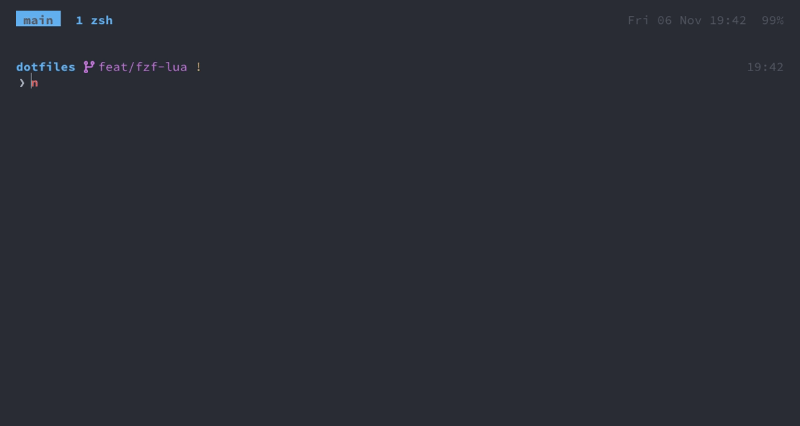

Neovim
===

Neovim from Homebrew, configured in Lua, with LSP, treesitter, fzf-lua and a set of plugins for moving
around quickly. `vim` runs nvim everywhere (a link in `~/bin`), including as git's editor.

What it is
---
- **Two prefixes**: the leader `,` starts an action, `;` opens a picker. Every key has a description that
  starts with its area (`Git: blame for this file`, `Split: zoom, and back`), so `;?` finds a key by what it
  does. These keys are the reference for VS Code and Android Studio, which get the same ones as far as they
  can ([vim-keys](vim-keys.md)).
- **Pickers** come from fzf-lua. They run the real fzf, so they look and work like the shell's and the tmux
  pickers: the boxes, colours and keys of `config/fzf/fzfrc` ([fzf](fzf.md)), the preview at the bottom, and
  the [picker keys](tmux.md#picker-keys). They open ready to type; `jj` goes to normal mode. Lists from
  `vim.ui.select` (xcodebuild's, `,ae`'s emulators, LSP code actions) are the same pickers.
- **System clipboard**: every yank and delete goes to the macOS clipboard, `p` pastes from it.
- **Files reload when changed on disk** as soon as you come back to nvim, its tmux pane or the buffer.
  Handy with agents and git working on the same files.
- **Format on save** with [conform.nvim](https://github.com/stevearc/conform.nvim): the project's own formatter
  if it has one (prettier from `node_modules` with a prettier config, ruff, goimports/gofmt, stylua with a
  `stylua.toml`, shfmt, SwiftFormat or swift-format with their config, ktlint when `.editorconfig` sets it
  up), otherwise the language server (never for Swift or Kotlin). For JS/TS, eslint additionally fixes what
  it can. `:ConformInfo` shows what a buffer uses.
- **Editing**: 2-space indent with spaces, no line wrapping, case-insensitive search, 10 lines of context when
  scrolling, `:s` shows a live preview of the substitution. Brackets, quotes and HTML/JSX tags close
  themselves (autopairs, ts-autotag), `.` repeats plugin actions too (vim-repeat), indent guides highlight
  the current scope.
- **Language servers** give definitions, references, rename and diagnostics. Diagnostics are shown as icons in
  the sign column and coloured line numbers, not as text at the end of the line. Each project's root is the
  git root, so a monorepo gets one server instance rather than one per package. Swift and Objective-C use
  `sourcekit-lsp` from Xcode; building and running iOS (`,i`) and Android (`,a`) apps is in [mobile](mobile.md).
- **Completion** ([blink.cmp](https://github.com/saghen/blink.cmp)) comes from the language server, file
  paths, snippets ([friendly-snippets](https://github.com/rafamadriz/friendly-snippets), expanded by nvim's
  own `vim.snippet`; TypeScript also gets the JavaScript ones) and words in the buffer. The first match shows
  as grey ghost text, the documentation of the selected item next to the menu, and the signature help while
  you type a function's arguments. `:BlinkCmp status` checks the setup.
- **Git** ([fugitive](https://github.com/tpope/vim-fugitive)): `:Git` runs any git command; its status, blame,
  log and commit messages are nvim buffers, so you move, search, select and yank in them as anywhere. In the
  status (`,gs`), `s` / `u` stage and unstage the file under the cursor or the lines selected in its inline
  diff (`=`), `cc` commits, `g?` lists the rest. gitsigns marks added, changed and deleted lines in the sign
  column. `;g` lists what the branch changes, for reviewing it (see [Reviewing a branch](#reviewing-a-branch)).
- **Terminals** are tmux panes: two shells per working directory (e.g. one for tests, one for anything else)
  come up in a pane below nvim and keep running while hidden ([tmux](tmux.md#what-it-is)).
- **File tree** (nvim-tree) on the right, following the current file and the working directory.
- **Code tours** ([codetour.nvim](https://github.com/roeeyn/codetour.nvim)): a tour is an ordered list of
  stops in the code, each with a note, saved as JSON in `<git root>/.codetour/`. The note shows above its line
  as a shaded block with a bar down the left: "stop 4 of 10 · tour" on top, then the whole note, wrapped at
  100 columns. A folder's `.nvim.lua` can point `storage_path` at tours kept elsewhere, e.g. a docs repo that
  tours code in its sibling repos.
- **Per-folder config**: a `.nvim.lua` (or `.nvimrc`, `.exrc`) in the folder nvim starts in, or in any folder
  above it, is loaded after this config (`exrc`). A file meant for one folder only checks `vim.fn.getcwd()`.
- **tmux**: `C-h/j/k/l` cross between nvim splits and tmux panes; true colour and undercurls work inside
  tmux; focus events trigger the reload of changed files.
- **Theme**: a base16 scheme shared with Ghostty, switched with `change_theme` ([theme](theme.md)).
- **Debugging**: `,vo` opens the current file and line in VS Code, in the project's window, to set
  breakpoints and debug there ([debugging](debugging.md)). Xcode (`,io`) and Android Studio (`,ao`) do the
  same for apps ([mobile](mobile.md)).
- **Status line** (lualine, one for all splits, flat blocks like tmux's): mode, git branch and diff counts,
  path relative to the working directory, diagnostics, active language servers, position.

Adding a plugin
---
1. Add it to `lua/user/plugins.lua`.
2. Create `lua/user/<name>/` with its `config.lua` and `keymaps.lua`, each key with a `desc` (`check_dotfiles`
   checks it), and require it from `init.lua`.
3. Restart nvim, then commit the updated `lazy-lock.json` with the change.

Updating plugins
---
[lazy.nvim](https://github.com/folke/lazy.nvim) installs itself on first start; the exact version of every
plugin is pinned in `lazy-lock.json`, which is committed.

- `:Lazy update` updates everything and rewrites the lock file. Try things out, then commit the lock file,
  or `git checkout lazy-lock.json` and `:Lazy restore` to go back.
- `:Lazy restore` installs exactly the pinned versions (`setup_dotfiles` does this).
- `:Lazy` shows the status of every plugin.

Adding a language
---
1. **Language server**: add its formula to the `Brewfile`, add a file for it in `lua/user/lsp/lspconfig/`
   like the existing ones, and require it in that directory's `init.lua`.
2. **Treesitter parser**: add the language to `lua/user/treesitter.lua`.
3. **Formatter**, if the language server's isn't the one: add it in `lua/user/conform.lua`.
4. Restart nvim.

Replacing across files
---
- `,sr` opens [grug-far](https://github.com/MagicDuck/grug-far.nvim) in a split; in visual mode the
  selection is the search. Fill in search, replacement, and optionally a files filter (`*.ts`) or ripgrep
  flags: the results update live, with the replacement shown as a diff. Search is ripgrep, including hidden
  files, case-insensitive unless the search has a capital letter. `\r` replaces in all files.
- Or the built-in way: send matches to the quickfix list (`;r`, mark entries with `Tab`, then `C-s`) and run
  `:cdo s/old/new/ | update`.

Reviewing a branch
---
1. `;g` (or `greview` in a shell) lists the files the branch changes since it left the default branch,
   committed or not, new files included, as a pull request's "Files changed": the status letter, the file,
   how many review comments it has. The preview is its diff through delta. On the default branch it lists
   what isn't pushed yet.
2. `Enter` opens the file beside its old side (fugitive's diff, the old side on the left): `]c` / `[c` go
   to the next / previous change, `do` takes the old version of a change back into the file.
3. `,n` on a line of the file's side writes a review comment ([Reviewing an
   agent](claude.md#reviewing-an-agent)); the old side is a revision, so `,n` there says to comment on
   the file instead.
4. `;g` again for the next file: the counts show which ones you've covered. `M-n` (`n` in normal mode)
   switches to `;n`'s list of the comments, to change or drop some, and `M-g` there comes back: alt plus the
   letter of the picker it opens.
5. `M-p` (`p` in normal mode) in either list sends every comment to the agent.

Keys
---
The leader is `,`. `;` starts the pickers.

<b>Show GIF</b>

`;f` finds a file, `,e` opens the tree, `C-h` and `C-l` cross between nvim and a tmux pane.

### Changed defaults

These override built-in vim keys, which is easy to forget:

| Key | Now | Built-in meaning you lose |
|---|---|---|
| `jj` (insert) | leave insert mode | |
| `x` | delete without yanking | |
| `m` | flash: jump to any visible position | set a mark (use `:mark`) |
| `H` `J` `K` `L` | treewalker: move by syntax node | screen top, **join lines**, keyword help, screen bottom |
| `Space` | next split, cycling: see [same key, every layer](design.md#same-key-every-layer) | |
| `Backspace` | back to the last split, as `C-w p` | move left, like `h` |
| arrow keys | resize the split: narrower, taller, shorter, wider, as `Shift+h/j/k/l` on the other layers | move the cursor |
| `Esc` | also clears search highlights | |
| `C-h/j/k/l` | move between splits and tmux panes | |
| `gd`, `gr` | definitions / references in Trouble | |
| `gra`, `gri`, `grn`, `grr`, `grt`, `grx` | removed, so `gr` doesn't wait for a third key | nvim's LSP defaults |
| `ga` | code actions, where a language server runs | show the character's code |
| `,` / `;` | the leader / the picker prefix | repeat the last `f` `t` `F` `T` backwards / forwards |

### Files, buffers, windows

| Key | Action |
|---|---|
| `,w` / `,q` | save / **quit without saving** |
| `]b` / `[b` | next / previous buffer (nvim's own keys) |
| `,bb` | alternate buffer |
| `,bd` / `,bdr` | close buffer / close all other buffers |
| `,bls` | list buffers |
| `,ss` / `,sv` | split horizontally / vertically and go to the new split |
| `,sh` `,sj` `,sk` `,sl` | go to the split left/down/up/right (same as `C-h/j/k/l`, but nvim only) |
| `,z` / `,=` | zoom the split (again: the layout as it was) / make all splits equal |
| `,dt` / `,do` | diff the visible splits / stop diffing |
| `,tt` / `,tm` | show or hide the two shells, in a tmux pane below; the same keys in zsh's normal mode hide them from inside |
| `,re` | reload the config |

### Finding things

| Key | Picker |
|---|---|
| `;f` | files, including dotfiles, respecting `.gitignore` |
| `;a` | all files, including ignored ones |
| `;g` | the files this branch changes, to review ([Reviewing a branch](#reviewing-a-branch)) |
| `;r` | live grep |
| `;s` | grep the word under the cursor |
| `;b` | open buffers |
| `;d` / `;w` | symbols in this file / in the workspace (LSP) |
| `;e` | diagnostics |
| `;q` | quickfix list |
| `;o` / `;l` | code tours / the stops of the open tour, see [Code tours](#code-tours) |
| `;n` | review comments not sent yet, `M-p` sends them to the agent, see [Code tours](#code-tours) |
| `;t` | help tags |
| `;?` | the keys: every key with a description, found by key or by what it does (`git`, `split`); nvim's own keys too |
| `;;` or `;c` | reopen the last picker with its query |

### In a picker

| Key | Action |
|---|---|
| `jj` | normal mode: `j`/`k`, `g`/`G`, `q`, `/` to type again |
| `Esc` | clear the filter, then quit |
| `Tab` | mark the entry (several files, matches, stops) |
| `C-s` | send the marked entries (or the current one) to the quickfix list and open it |
| `C-x` / `C-v` / `C-t` | open in a split / vertical split / tab |
| `?` (normal mode) | list the keys: fzf-lua's list, with the picker's own keys, as `F1`; `?` again closes it |
| `C-/` | show / hide the preview |
| `C-n` / `C-p` | next / previous entry, while typing too, as in completion |
| `C-M-n` / `C-M-p` | scroll the preview half a page |
| `M-d`, or `d` in normal mode | `;b`: close the buffer |

### Moving around

| Key | Action |
|---|---|
| `m` | flash: type a few characters of the target, then the label that appears there. Works after operators and in visual mode: `dm`, `ym`, `vm` |
| `,m` / `;m` | harpoon: add the file to the list / open the list (reorder and delete in it) |
| `;j` / `;k` | harpoon: next / previous file in the list |
| `,e` | file tree on the right (`l` opens, `g?` shows all keys) |
| `,f` | file tree with the current file revealed |
| `,so` | outline of the symbols in the file |

### Code (LSP)

| Key | Action |
|---|---|
| `gd` | definitions (Trouble list) |
| `gr` | references (Trouble list) |
| `ga` | code actions (only where a language server runs) |
| `,rn` | rename |
| `,hd` | hover documentation |
| `,hs` / `C-s` in insert mode | signature help |
| `]d` / `[d` | next / previous diagnostic, with the message in a float |
| `,xx` / `,xd` | Trouble: all diagnostics / this buffer's |

### Syntax-tree navigation (treewalker)

In normal and visual mode, so `vJJ` selects across nodes.

| Key | Action |
|---|---|
| `J` / `K` | next / previous node at the same level (e.g. function to function) |
| `L` / `H` | into the first child / out to the parent |
| `,j` / `,k` | swap the node with the next / previous one |
| `,hn` | briefly highlight the node under the cursor |
| `din`, `yin`, `cin` | operate on the node under the cursor |
| `an` / `in` (visual) | grow / shrink the selection by node (built into nvim) |

### Completion and snippets

| Key | Action |
|---|---|
| `Tab` / `S-Tab` | next / previous item; otherwise expand or jump in a snippet; otherwise open completion |
| `C-n` / `C-p` | next / previous item |
| `Enter` | accept |
| `C-e` | close the menu |
| `C-h` / `C-l` | scroll the documentation window |
| `C-j` / `C-k` | next / previous snippet placeholder |

### Editing helpers

| Key | Action |
|---|---|
| `cs"'` / `ds(` / `ysiw"` | nvim-surround: change surrounding quotes / delete parentheses / surround a word |
| `S"` (visual) | surround the selection |
| `dsf` | delete a function call around its arguments |
| `dst` / `cst` | delete / change an HTML tag |
| `:S/child{,ren}/adult{,s}/` | vim-abolish: substitute all case and plural variants |
| `crs` / `crc` / `crm` / `cru` | vim-abolish: coerce the word to snake / camel / Mixed / UPPER case |

### Git

| Key | Action |
|---|---|
| `,gs` | fugitive's status in a split: `s` / `u` stage / unstage, `=` the inline diff, `cc` commit, `dv` the diff side by side, `g?` the keys, `gq` closes it |
| `,gb` | blame in a side window: `Enter` opens the commit of the line, `~` blames from the commit before it, `gq` closes it |
| `,go` | open the file on GitHub (`gh browse`), on this branch once it's pushed; in visual mode, the selected lines |
| `,gp` / `,gn` | open this branch's pull request / create one (`gh pr view` / `gh pr create`, in the browser) |
| `,gd` / `,gD` | diff this file against HEAD / close the diff; a file HEAD doesn't have yet shows against an empty side, all of it added |
| `,gr` / `,gR` | pick a commit to revert / a commit of this file; the preview shows it through delta. `,gr` reverts it with `--no-commit`, staged for you to commit; `,gR` takes back only its change to this file, unstaged |
| `;g` | the branch's changed files ([Reviewing a branch](#reviewing-a-branch)) |
| `:Git <anything>` | any git command, its output in a buffer: `:Git log`, `:Git push`, `:Gclog` (commits into the quickfix list) |
| `:Gitsigns <Tab>` | gitsigns' actions: preview, blame line, … (no keys bound; staging is fugitive's) |

### Search and replace (grug-far)

| Key | Action |
|---|---|
| `,sr` | open grug-far; in visual mode, with the selection as the search |
| `\r` | replace in all files |
| `\s` | sync: write manual edits of the result lines back to their files |
| `Enter` | open the match under the cursor |
| `g?` | all keys |

### Code tours

| Key / command | What |
|---|---|
| `;o` | pick a tour, its stops in the preview, and open it: notes on, stops in the quickfix list |
| `:CodeTour open` | reopen the last tour, or pick one as `;o` |
| `;l` (`:CodeTour list`) | the open tour's stops by note, in order; the preview shows the whole note above its code, the path on top |
| `]q` / `[q`, `[Q` / `]Q` | next / previous stop, first / last (nvim's quickfix keys; a count skips ahead) |
| `:CodeTour` | all stops with a preview; reorder lines, edit notes, `:w` saves |
| `:CodeTour toggle-notes` | hide / show the notes |
| `:CodeTour close` | end the tour and restore the previous quickfix list |
| `:CodeTour create <name>`, `:CodeTour add <note>` | start a tour, add the cursor line as a stop |
| `,n` / `;n` | the review comment on this line, new or to change / the ones not sent yet: the tour `review`, sent to the Claude Code agent with `M-p` ([Reviewing an agent](claude.md#reviewing-an-agent)) |

A note is written in a window of its own (`,n`, `M-r`), a markdown buffer with vim's keys:

| Key | What |
|---|---|
| `:w` (`:wq`, `ZZ`) | save the note and close the window; saved empty, the stop is deleted |
| `q` in normal mode, `:q` | close without saving; so does leaving the window |

In the tour pickers, as `M-d` / `d` in `;b`:

| Key | `;o` tours | `;l` stops, `;n` review comments |
|---|---|---|
| `Enter` | open the tour | jump to the stop |
| `M-d`, or `d` in normal mode | delete the tour (asks first) | remove the stop |
| `M-r`, or `r` in normal mode | – | change the stop's note, in the note window |
| `M-p`, or `p` in normal mode | – | `;n` only: paste every comment into the agent's prompt and go there |
| `M-g` | – | `;n` only: switch to the files they're about (`;g`), whose `M-n` (`n` in normal mode) comes back |
| `C-s` | – | send the stops to the quickfix list |

Config
---
`config/nvim/` is linked to `~/.config/nvim`.

| File | Contains |
|---|---|
| `init.lua` | loads everything in order: options, keymaps, then one module per plugin |
| `lua/user/base.lua` | options |
| `lua/user/keymaps.lua` | general keys |
| `lua/user/plugins.lua` | the plugin list |
| `lua/user/<plugin>/` | per plugin, and per nvim tool of its own (`android/`, `vscode/`): `config.lua` (setup) and `keymaps.lua` |
| `lua/user/describe.lua` | adds a description to a key a plugin binds itself (vim-tmux-navigator, vim-abolish), leaving the mapping as it is |
| `lua/user/conform.lua` | formatters |
| `lua/user/lsp/lspconfig/` | one file per language server, required from its `init.lua` |
| `lua/user/treesitter.lua` | the treesitter parsers |
| `lua/user/hidden/init.lua` | gitignored, loaded if present: private settings |
| `lazy-lock.json` | the pinned plugin versions |

Every key is bound in a `keymaps.lua` (a check fails on one bound anywhere else), so to find a key, look in
the `keymaps.lua` of the plugin it belongs to. That includes keys a plugin only takes from its setup, like
nvim-tree's buffer keys: `keymaps.lua` exports them and `config.lua` passes them on, and the keys inside the
pickers (`fzf-lua/keymaps.lua`, `codetour/keymaps.lua`).

| Language | Server | Parsers |
|---|---|---|
| TypeScript / JavaScript | `ts_ls`, `eslint` | TypeScript, TSX, JavaScript |
| Lua | `lua_ls`, aware of the nvim API | Lua |
| Go | `gopls` | Go, with mod/sum/work files |
| Kotlin | JetBrains' `kotlin-lsp` | Kotlin, Groovy, XML (Gradle and Android files) |
| Swift, Objective-C | `sourcekit-lsp` from Xcode | Swift |
| YAML | `yamlls` | YAML |
| Others | – | Bash, JSON, TOML, Markdown, HCL/Terraform, Helm |

Language servers come from the Brewfile; parsers are compiled with the `tree-sitter` CLI (`setup_nvim` waits
for them; otherwise the first start downloads them).

To look out for
---
- `,q` quits **without saving**.
- `,re` reloads most of the config in place; plugin changes need a restart.
- Language servers aren't enabled automatically: a new one has to be required in `lsp/lspconfig/init.lua`.
- `ts_ls` uses the project's own TypeScript from `node_modules`, so a lone `.ts` file outside a project gets
  no language server.
- Helm templates get syntax highlighting but no diagnostics, which would all be false alarms.
- fzf has no two-key sequences, so closing a buffer in `;b` is `d`, not `dd`.
- `C-Space` belongs to tmux, so completion opens with `Tab` and closes with `C-e`.
- nvim asks once whether to trust each per-folder config and asks again when it changes, so a cloned repo
  can't run code you haven't seen. `:trust` / `:trust ++deny` change the answer later.
- Code tours don't reopen on start: `:CodeTour open` reopens the last one.

Decisions
---
- **Language servers from the Brewfile, not Mason**: like every other tool, so `brew upgrade` updates them.
- **The language servers run on Homebrew's node, not fnm's**: the TypeScript, ESLint and YAML servers start
  with Homebrew's node by its full path, so they work whichever node a project pins. fnm owns the `node` you
  type (`docs/design.md`, "One tool per job"), so Homebrew's node and its TypeScript are installed but not
  linked (`link: false` in the Brewfile) and never reach `PATH`.
- **fzf-lua, not telescope**: it runs the real fzf, so nvim's pickers are the same as the shell's and tmux's
  (`docs/design.md`, "One tool per job").
- **Code tour notes drawn by this config**: the plugin's own note is one line that runs off the window.
- **Review comments are a code tour, not a plugin of their own**: the tour already draws notes above lines,
  follows edits and has a picker, so `,n` / `;n` add only the sending. Pasted, not submitted, so you read the
  message in the agent's prompt first; `M-p`, not `M-s`, which is AeroSpace's.
- **Shells in tmux, no terminal plugin**: tmux owns terminals (`docs/design.md`, "One tool per
  job"), so they are in tmux's tree, saved across reboots, and `C-h/j/k/l` reach them. That includes the
  Gradle and logcat shells ([mobile](mobile.md)): nvim types its commands into them with `tmux send-keys`.
- **fugitive, not lazygit**: lazygit ran in a tmux popup and needed glue (its own config, `nvim --remote`) to
  open a file back in nvim; fugitive's status, blame, diffs and commit messages are nvim buffers, so vim's keys,
  the quickfix list and diff mode work in them without it. lazygit was better at moving commits around and
  drawing the branch graph, which Claude Code's rebases and `agent_land` now cover. fugitive replaced git.nvim
  too; its GitHub links went to `gh` (`docs/design.md`, "One tool per job").
- **`;g` is the changed files, not git's files**: `;f` already lists the same files, bar untracked ones, so
  `;g` went to the list a review starts from.
- **No projects picker (`;p`)**: a project is a tmux session (`cmd+k`), so moving to another one happens in
  tmux, not by changing nvim's working directory (`docs/design.md`, "One tool per job").
- **nvim-tree in nvim, yazi in the shell, both on `,e`**: the tree stays open beside the file you edit and
  opens files in this nvim; yazi has no nvim inside it and is a whole-screen browser with previews for the
  shell. One job, files to open, so one key; which tool depends on where you are, as with `;f`.
- **Three lists that aren't the picker**, because each stays open while you work, which a picker can't:
  trouble's diagnostics and references (`,xx`, `gr`) sit in a split while you fix them one by one, the
  outline (`,so`) is a sidebar that follows the cursor, and harpoon's list (`;m`) is a buffer you reorder and
  delete in with vim's own keys. Anything you choose from and leave goes through fzf-lua.
- **nvim's `gr…` LSP keys removed**, so `gr` (references) doesn't wait for a third key.
