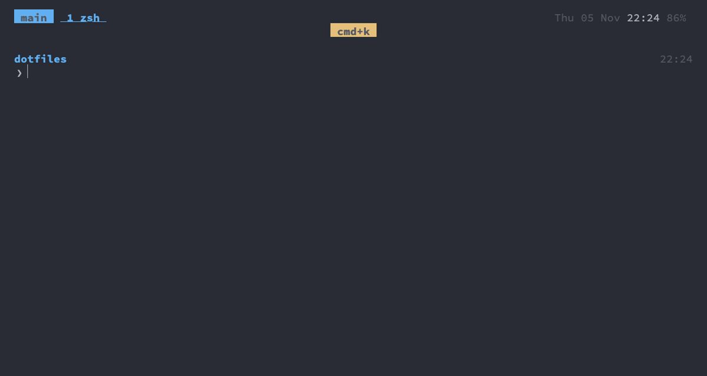
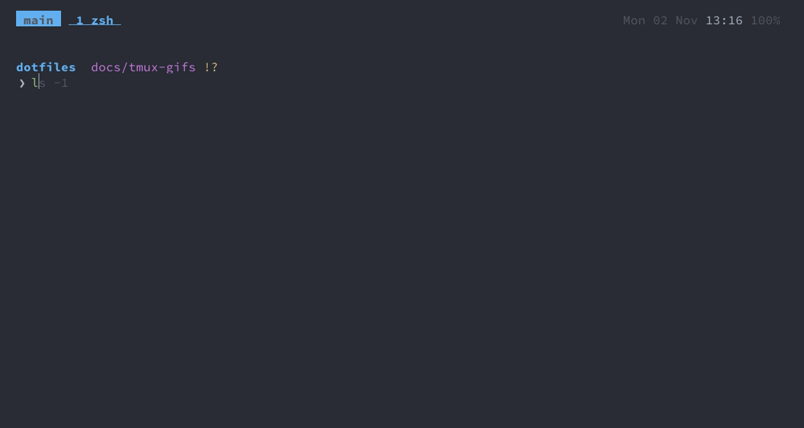

tmux
===

tmux is where everything lives. Ghostty attaches to it, every project gets a session, and sessions survive
closing Ghostty and, thanks to resurrect/continuum, rebooting the Mac.

What it is
---
- **Session** per project: created by the session picker from a directory, named after it. `main` is the
  one Ghostty opens.
- **Window** per task: an editor, a dev server, a Claude Code agent. Windows are numbered from 1, matching
  `cmd+1`…`9`, and renumbered when one closes.
- **Panes** for things you want side by side. Splits and new windows start in the current pane's directory.
- Closing the last window of a session switches to another session instead of closing the terminal.
- **Shells that wait**: `,tt` and `,tm` (nvim, and zsh's normal mode) show a shell in a pane below, one each per
  directory; the same key hides it again, still running, into the session `_scratch`, which no picker lists.
  It is a real pane: `C-h/j/k/l`, zoom and `cmd+w` work on it ([neovim](neovim.md)). nvim's Android keys
  run Gradle and logcat in two more of these, at the project root ([mobile](mobile.md)).
- **Moving between panes and nvim**: `C-h/j/k/l` work without the prefix: vim-tmux-navigator checks whether
  the pane runs nvim and, if so, lets nvim move between its own splits first. Inside nvim the same keys cross
  into tmux panes.
- **Saved across reboots**: tmux-resurrect saves sessions, windows, panes, their directories and contents;
  tmux-continuum does it every 15 minutes and restores automatically when the tmux server starts.
- **Copying** goes to the macOS clipboard, from copy mode and from mouse selections. Copies also travel over
  ssh: tmux sends them to Ghostty as OSC 52, so text copied in a remote tmux lands in the local clipboard.
- **Terminal capabilities** are set up so nvim inside tmux looks the same as outside: true colour, undercurls
  and coloured underlines (diagnostics), focus events (nvim reloads files changed on disk), no delay on
  `Esc`, OSC 52 clipboard and passthrough (images, notifications). The window title in Ghostty shows
  `session · window`.

### Session picker

`cmd+k` (or `tm` in a shell outside tmux) opens fzf with the running sessions first, then every directory
zoxide knows, most used first, those in your home as `~/…`. Choosing a directory creates a session there named
after it, or switches to it if it exists. Outside tmux, `tm` attaches. So the directories you `z` into in the
shell are the projects you can jump to ([zsh](zsh.md#jumping-to-a-directory)).

It opens in a popup that looks like fzf in the shell: the terminal's background, rounded boxes, the theme's
colours. The preview, below the list as in the tree and the agents picker, shows a session's screen or a
directory's files, and its label which one; the sessions' agent marks and the preview update while it's
open. It opens ready to type; `jj` switches to moving with `j`/`k` ([picker keys](#picker-keys)).

<b>Show GIF</b>

`cmd+k` opens a project as a session, `cmd+j` shows the tree, `cmd+shift+0` goes back to the last session.

### Tree

`cmd+j` shows every session and window, drawn as tmux's own tree (`choose-tree`): `├─>` / `└─>` lines, a
session's window count and whether it's attached, window flags (`*` current, `-` last), and the panes of
windows that have more than one. Each line carries the mark of its most urgent agent and what its agents work
on. It's fzf in a popup, so it has the [picker keys](#picker-keys); it opens on the current window, list and
preview update while it's open, and the preview's label says which window it shows. `Enter` switches to the
session, window or pane. Two keys act on the line, in normal mode as in nvim's pickers (`alt-` the same letter
while filtering):

| Key | Action |
|---|---|
| `d` / `alt-d` | kill the session, window or pane: asks first, `y` kills, anything else keeps it |
| `r` / `alt-r` | rename the session or window (a pane's line renames its window): the prompt has the current name |

### Pickers

The fzf pickers share their keys. This is the list of them, and the other pages point here: the session
picker (`cmd+k`), the tree (`cmd+j`), the agents (`cmd+shift+j`), GitHub (`cmd+g`), the paste buffers
(`C-a P`), `agent_resume`, `mdv`, `zi`, `change_theme`, git's `gsw` and `gfix`, kubectl's `kctx`, `kns`, `klo`
and `kex`, the shell's history search (`C-r`, [zsh](zsh.md#searching-history)), zsh's `;` keys
([zsh](zsh.md#vi-mode)) and nvim's `;` pickers ([neovim](neovim.md#finding-things)). They have the same keys
and work like nvim: a normal mode to move and an insert mode to type a filter. The session picker,
`change_theme`, the history search and nvim's pickers open ready to type, the others in normal mode. The
filter box stays on screen in both modes, so the list doesn't jump when you start or stop typing; the prompt
shows the mode: `session> ` while typing, `session: ` in normal mode, where an empty filter says `/ to
filter` in grey. A picker appears with its list already in and closes as soon as you leave it.

### Status bar

At the top. Left: the session name. Then the windows: current one in bold blue, a zoomed one with a fullscreen
icon, and **a window that rang the bell in yellow with a bell icon** until you visit it. Programs ring the
bell when they want attention. A window running Claude Code shows its agent's state instead: waiting 󰂞, done
but not seen 󰄬, working 󰔟 (see [claude-code](claude-code.md#noticing-an-agent-that-waits)). Right: how many
agents are in each state across all sessions, your pull requests and notifications on GitHub (see
[github](github.md)), a `PREFIX` badge while the prefix is pressed, date, time, battery. Windows are two
spaces apart, as the session name and the first window, and so are the groups on the right; the date, time and
battery are grey, as the prompt's time below, and end flush with the edge.

The tree (`cmd+j`) and the session picker (`cmd+k`) show the same marks: on each pane, window and session,
the most urgent agent in it. Visiting a window marks its finished agents as seen.

It uses only the 16 ANSI colours, so it follows the [theme](theme.md). So do popups, menus, tmux's own tree
(`C-a s`), search matches and the command prompt.

Updating plugins
---
tpm manages the plugins, installed under `~/.tmux/plugins` (outside the repo). `C-a I` installs newly added
plugins, `C-a U` updates them.

Keys
---
The prefix is `C-a`. Press it twice to send a literal `C-a` to the program. The `cmd` column is what Ghostty
sends for you, see [ghostty](ghostty.md).

<b>Show GIF</b>

Splitting, moving between and zooming panes, then a new window.

| Key | cmd | Action |
|---|---|---|
| `C-a c` | `cmd+t` | new window |
| `C-a \|` / `C-a -` | `cmd+d` / `cmd+shift+d` | split right / down |
| `C-a x` | `cmd+w` | close pane |
| `C-a 1`…`9` | `cmd+1`…`9` | go to window |
| `C-a [` / `C-a ]` | `cmd+[` / `cmd+]` | previous / next window (copy mode and paste, tmux's own `[` / `]`, are on `C-a Enter` and `C-a p`) |
| `C-a l` | `cmd+0` | back to the last window |
| `C-a ;` | `ctrl+0` | back to the last pane |
| `C-a (` / `C-a )` | – | previous / next session, past `_scratch` (no Cmd key, see [Decisions](#decisions)) |
| `C-a S` | `cmd+shift+0` | back to the last session (tmux's own key for it, `C-a L`, resizes panes here) |
| `C-a z` | `cmd+shift+enter` | zoom pane |
| `C-a f` | `cmd+k` | [session picker](#session-picker), ready to type ([picker keys](#picker-keys)) |
| `C-a w` | `cmd+j` | [tree](#tree) of sessions and windows, with previews: the quickest way to switch to any of them; `d` kills, `r` renames |
| `C-a a` | `cmd+shift+j` | the Claude Code agents only, in a popup: most urgent first, each with its state and what it's working on, and a live preview of its screen. Opens in normal mode: `j`/`k` move, `/` filters ([picker keys](#picker-keys)) |
| `C-a g` | `cmd+g` | your pull requests and GitHub notifications in a popup, most urgent first, with checks or the thread in the preview ([github](github.md#keys)) |
| `C-a A` | `cmd+shift+space` | the next Claude Code agent that needs you, in any session: waiting ones first, then done ones; again for the one after; `cmd+0` back, or `cmd+shift+0` from another session |
| `C-a /` | `cmd+f` | search the scrollback upwards (`n` / `N` for more) |
| `C-a ,` / `C-a $` | `cmd+r` / `cmd+shift+r` | rename the window / session. The prompt opens in the status bar with the current name; `C-u` clears it |
| `C-a H/J/K/L` | | resize pane (repeatable), as `alt+shift+h/j/k/l` in AeroSpace |
| `C-a =` | | make all panes equal (`C-a P` chooses a paste buffer, tmux's own `=`) |
| `C-a d` | | detach |
| `C-a r` | | reload the config |
| `C-a C-s` / `C-a C-r` | | resurrect: save / restore all sessions |
| `C-a I` / `C-a U` | | tpm: install / update plugins |
| `C-h/j/k/l` | | move to the pane left/down/up/right, *including nvim splits* |
| `C-a C-l` | | clear the screen (`C-l` moves to the pane on the right) |
| `C-Space` | | next pane, cycling: see [same key, every layer](design.md#same-key-every-layer) |

### Picker keys

| Key | Mode | Does |
|---|---|---|
| `j` / `k` | normal | next / previous line, wrapping round from the last to the first and back |
| `g` / `G` | normal | first / last line |
| `ctrl+d` / `ctrl+u` | normal | half a page down / up |
| `/` | normal | type a filter |
| `jj` | typing | back to normal mode, keeping the filter, so `j`/`k` move through what it matched |
| `Esc` | both | clear the filter and go back to the mode the picker opened in; there, with no filter, quit |
| `q` | normal | quit |
| `Enter` | both | choose the line |
| `?` | normal | list the keys below the list (the list's label, `? keys`, says so); `?` again hides them |
| `ctrl+/` | both | show / hide the preview (every fzf list, see [fzf](fzf.md#inside-any-fzf-list)) |

### Copy and paste

| Key | Action |
|---|---|
| `C-a Enter` | enter copy mode (scrolling with the mouse does too) |
| `v` / `C-v` | start selection / toggle block selection |
| `y` | copy and leave |
| `H` / `L` | start / end of line |
| `Esc` | leave |
| `C-a p` | paste the last buffer |
| `C-a P` | the paste buffers in a picker, newest first, the whole text in the preview; `Enter` pastes the chosen one ([picker keys](#picker-keys)) |
| `C-a :` | the command prompt, also used by renaming and `/` search: vi keys (`status-keys vi`), opens in insert mode, `Esc` goes to normal mode |

Config
---
| File | Contains |
|---|---|
| `config/tmux/tmux.conf` (linked to `~/.config/tmux/`) | everything; reload with `C-a r` |
| `config/tmux/scratch` | the `,tt` / `,tm` shells and nvim's Gradle and logcat ones: shows, hides and finds each one by its name and directory; `--show` prints its pane for nvim to type into |
| `config/tmux/picker.zsh` | the shared part of every picker: `picker_modes`, which nvim's pickers ask for their modes too; it also keeps the list and the preview of the tmux pickers current, redrawing only what changed |
| `~/.tmux/plugins` | the plugins, installed by tpm, outside the repo |

| Plugin | Does |
|---|---|
| vim-tmux-navigator | `C-h/j/k/l` across tmux panes and nvim splits |
| tmux-resurrect | saves and restores all sessions, windows, panes, their directories and contents |
| tmux-continuum | saves every 15 minutes and restores automatically when the tmux server starts |

To look out for
---
- `C-h/j/k/l` don't reach programs in the shell: `C-l` no longer clears the screen, `C-a C-l` does.
- `C-Space` always goes to tmux, even in nvim: there it no longer opens completion (`Tab` does).
- resurrect brings back the layout, directories and pane contents, but running programs are not restarted
  (except a few like `vim`), so an agent or dev server shows up as a shell.
- fzf has no timeout for the second `j`: `jj` in a filter always leaves typing.
- After a change to `tmux.conf`, reload it (`C-a r`): a running server keeps the old config. One started before
  `@listed` (which hides `_scratch`) lists every session in the pickers, `_scratch` too.
- The tree can't collapse sessions, tag or run a command on the tagged ones as `choose-tree` does, and a
  filter matches the text of each line, so a window matches by its own name, not its session's.
- Remote hosts often lack the `tmux-256color` terminfo, so inside tmux the `ssh` alias connects with
  `TERM=xterm-256color`.

Decisions
---
- **`C-a` as the prefix**: with Caps Lock as Ctrl, it's a left-hand roll.
- **No Cmd key for previous / next session**: too close to `cmd+[` / `cmd+]`, previous / next window.
- **`C-a S` for the last session**: tmux's own `C-a L` resizes panes here, as `H/J/K/L` on the other layers.
- **tmux's own tree stays on `C-a s`, next to the `cmd+j` tree**: it collapses sessions, tags and runs a
  command on the tagged ones, which a list in the picker can't; `cmd+j` is for going somewhere and tidying up
  on the way (`d` kills, `r` renames, nvim's picker keys), with the picker's marks.
- **`d` in the tree asks first, unlike `alt-d` in nvim's buffers**: a window or session may hold an agent or a
  server still running, and a killed one can't be brought back.
- **The current window in bold, not underlined** as tmux 3.8 does by default.
- **The `,tt` / `,tm` shells in a pane, not a popup**: a popup that keeps its shell running while hidden needs
  a tmux client nested inside it, and that holds every `Esc` for half a second.
- **Popups centred by the config**: tmux's own centring is a column and a row off.
- **tmux 3.8's fixed shades mapped onto the ANSI colours**: it colours popups, menus and the prompt from a
  theme of fixed shades (a grey popup background, `skyblue3`, …), which wouldn't follow the theme.
- **Scrollback is read in copy mode, not in nvim**: the text is already in the pane, with its colours, and
  copy mode moves through it with vi keys. Sending it to nvim would take a key of its own and a temporary
  file to show what `C-a Enter` shows in place.
