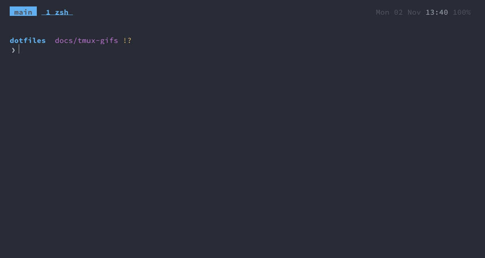

zsh
===

Homebrew's zsh is the login shell, without a framework: three plugins from Homebrew, vi keys on the command
line, a starship prompt, atuin for history and zoxide for jumping between directories. A new shell is
ready in about 45 ms on an M5 and about 75 ms on an M1 Max (220 ms with Oh My Zsh and zsh-vi-mode).

What it is
---
- **Loading**: `~/.zshrc` is a link into the repo. It finds the repo through that link, exports it as
  `real_script_dir` for the functions (also in a shell that has them without reading `.zshrc`, such as Claude
  Code's), and sources the files in [Config](#config) in order.
- **Start-up** stays fast because nothing slow runs at start. `starship init`, `zoxide init`, `fzf --zsh`,
  `atuin init`, vivid's colours and lesspipe print shell code; `cached_eval` (in `.zshrc`) keeps that output
  in `~/.cache/zsh` and only reruns the tool when it was upgraded. Homebrew's environment is written out
  instead of running `brew shellenv`. Completion is initialised from a dump in `~/.cache/zsh`, rebuilt and
  security-checked once a day.
- **Completion** goes through fzf (fzf-tab), matches case-insensitively and inside words, and `cd -<Tab>`
  picks from the directories visited in this shell. Typing a directory name alone `cd`s into it.
- **Vi mode** is zsh's own (`bindkey -v`) with a few additions in `zsh/.zshdefault`. The command line starts
  in insert mode, `jj` switches to normal mode, where the usual vim motions and operators work. The cursor is
  a bar in insert mode and a block in normal mode. In normal mode, `;` and `,` are nvim's keys (its pickers
  and leader), so a key learnt in one works in the other. Each one puts the command it runs on the command
  line, so it lands in the history, and what you had typed comes back afterwards.
- **History** is kept twice. `~/.zsh_history` keeps 100 000 commands with timestamps, shared between all open
  shells, with duplicates removed (only the latest copy of a repeated command is kept); the up arrow and the
  grey suggestions use it. [atuin](https://atuin.sh) keeps a second copy in SQLite with the directory, exit
  code and duration of each command; `C-r` searches it in fzf, so it looks and works like every other picker.
- **Prompt** (starship): two lines, context on the first, your input on the second after a `❯` that turns red
  when the last command failed and flips to `❮` in vi normal mode. The first line shows the directory
  (shortened to the repo root), git branch, state and status, and only where relevant: kubernetes context and
  namespace, the gcloud project inside git repos (in red with `PROD` when its name contains "prod"), node /
  python / go version in projects of that language, how long the last command took (over 2 s) and background
  jobs. At the right end, the time the prompt appeared, so scrolling back shows when each command finished.
  Each part has its Nerd Font icon; all colours are ANSI names, so the prompt follows the [theme](theme.md).
- **Directories**: zoxide learns the directories you visit. The same list feeds the tmux session picker
  (`cmd+k`), so projects you `z` into become sessions you can open with two keystrokes.
- **Pager and colours**: `less` keeps colours and, through lesspipe, shows the contents of archives and
  other binary formats. `man` opens the page in nvim, read-only, so it moves and searches like any file, `gO`
  lists its sections, `K` on a word opens that page and `q` quits. `bat` and the file colours for eza, fzf-tab
  and completion (`LS_COLORS`, generated by vivid) use the terminal palette, so they follow the
  [theme](theme.md).

Searching history
---

<b>Show GIF</b>

The up arrow searches by prefix, grey suggestions come from history, `C-r` searches atuin's history in fzf.

- Type the start of a command and press `↑`: only entries starting with it come up. A grey suggestion from
  history appears as you type; `→` or `End` accepts it.
- `C-r` (`/` in normal mode) opens atuin's history in fzf: newest first, each command once, with how long it
  ran (red when it failed) and how long ago.
- Type to search; `jj` switches to moving with `j`/`k`, as in every picker
  ([picker keys](tmux.md#picker-keys)). `C-r` again cycles the filter, shown on the list's border: everywhere
  (`global`), this Mac (`host`), this session, this git repo (`workspace`), this directory.
- `ctrl+/` shows the whole command, wrapped, with its directory and exit code. `Enter` puts the command on the
  command line, ready to edit or run.
- `atuin stats` shows your most used commands; `atuin search --exit 0 --cwd . <text>` searches from scripts;
  `atuin search -i` opens atuin's own search.

Jumping to a directory
---
- `z foo` jumps to the most frecent directory matching `foo` (`z foo bar` for both words).
- `zi foo` picks among the matches in the [picker](tmux.md#picker-keys), with a tree of each directory below.
- `Alt+C` (fzf) changes into any subdirectory.

Switching language versions
---
- **node**: fnm. Entering a directory with `.nvmrc`, `.node-version` or a `package.json` `engines` field
  switches to that version (in subdirectories too), installing it first if it's missing; a version that can't
  be installed is reported in red, never skipped quietly. A new shell does the same where it opens. Elsewhere
  the default version is used; it is on `PATH` everywhere, and it is the only `node`, `npm` and `tsc` there.
  `fnm install <v>`, `fnm default <v>`.
- **python**: [uv](https://docs.astral.sh/uv/). `python` / `python3` are the latest version (from
  `setup_python`); in a project, `uv init`, `uv add <pkg>`, `uv run <script>` manage the virtualenv and
  `uv python pin <v>` its version. `uv tool install <pkg>` installs a CLI tool, `uvx <pkg>` runs one once.
- **go**: from Homebrew.

Measuring start-up
---
`timezsh` measures the start with hyperfine; run it before and after adding anything to the shell. The time
depends on the Mac (an M1 Max takes about 1.7 times as long as an M5), so compare on the same Mac rather than
against a fixed number.

Keys
---
### Vi mode

Normal mode has vim's motions and operators: `dw`, `cb`, `yy`, `p`, `.` repeats, `~` / `gu` / `gU` change case.

| Key | Mode | Action |
|---|---|---|
| `jj` | insert | normal mode |
| `u` / `C-r` | normal | undo / redo |
| `v` / `V` | normal | select characters / lines |
| `vv` | normal | edit the command line in nvim |
| `iw` / `aw`, `i"` `a(` `i]` `i{` … | after an operator | text objects: word, quotes, brackets (`b` = `()`, `B` = `{}`): `ci"`, `da(`, `yi]` |
| `cs"'` / `ds(` / `ysiw"` | normal | surround: change `"…"` to `'…'` / remove the parentheses around the cursor / quote a word |
| `S"` | visual | quote the selection |
| `↑` / `↓` | both | previous / next history entry *starting with what you've typed* |
| `→` or `End` | insert | accept the grey suggestion |
| `C-k` / `C-j` | normal | the same as `↑` / `↓`, on the home row (outside tmux; inside tmux these keys move between panes) |
| `C-r` | insert | history search (atuin's history in fzf) |
| `/` | normal | the same |
| `;f` / `;a` | normal | open a file in nvim: any but ignored ones / all (`find_file` in `.fzf.zsh`) |
| `;g` | normal | the branch's changed files, to review in nvim (`greview`, see [neovim](neovim.md#reviewing-a-branch)) |
| `;r` | normal | grep the project as you type, open the match in nvim at its line (`fif`) |
| `;p` | normal | projects: the sessionizer (`tm`) |
| `,gs` / `,e` | normal | git status in nvim (`gs`) / yazi |
| `,tt` / `,tm` | normal | show or hide nvim's two shells for this directory, in a tmux pane below; inside one, hide it |
| `Tab` | insert | completion through fzf, see [fzf](fzf.md#completing-with-tab-fzf-tab) |

Commands
---
### Aliases and functions

| Command | Does |
|---|---|
| `ll`, `la` (`l`), `lt` | eza: long listing with git status and icons; with hidden files; tree two levels deep |
| `gs` | git status in nvim (fugitive), see [git](git.md#staging-and-committing) |
| `tm` | tmux session picker |
| `agent`, `agent_review`, `agent_land`, `agent_ci`, `agent_done`, `agent_resume` | Claude Code agents in worktrees and tmux windows of their own, see [claude-code](claude-code.md#commands) |
| `mdv [dir]` / `mds [dir]` | markdown files: rendered in the terminal / as a local site in the browser, see [fzf](fzf.md#reading-markdown-mdv) |
| `fif <text>` | files containing the text, with a preview of the matches |
| `change_theme` | pick a base16 scheme for nvim and Ghostty, see [theme](theme.md) |
| `npm_gh_token` | gives npm gh's token for GitHub's npm registry, after `gh auth refresh`; `check_mac` says when (`zsh/functions/zsh.zsh`) |
| `k`, `kg`, `kd`, `kgpo`, … | kubectl: `k` + verb (+ resource), the full list is at the end of `zsh/.aliases` |
| `kctx`, `kns` | kubectl: switch the context / the namespace, given or picked in fzf (`zsh/functions/kubectl.zsh`) |
| `klo`, `kex` | kubectl: follow a pod's logs / a shell in it (bash, else sh), the pod given or picked in fzf |
| `copy_last_cmd` | copy the previous command to the clipboard |
| `sn` / `sp` | Spotify next / previous track |
| `timezsh` | benchmark shell start-up (hyperfine), see [Measuring start-up](#measuring-start-up) |
| `fix_completion_dirs` | fix zsh's *insecure directories* warning, see [To look out for](#to-look-out-for) |

### Other command-line tools

From the Brewfile, worth knowing about:

| Command | Does |
|---|---|
| `gh` | GitHub from the terminal: `gh pr create`, `gh pr checks`, `gh run watch`, `gh pr checkout <n>` |
| `xh` | HTTP requests with httpie's syntax: `xh POST api.example.com name=x`, `xh -d <url>` downloads |
| `btop` | processes, CPU, memory, disks and network; vim keys (`j`/`k`, `g`/`G`; help and kill on `H`/`K`), the terminal's colours. Settings go in `config/btop/btop.conf`: btop's menu changes them only until it quits |
| `yazi` | file manager with previews; `q` quits, `?` lists keys |
| `img <file>` | chafa: shows a photo or plays a GIF in the terminal, sized to the pane; `ctrl-c` stops a GIF |
| `tldr <cmd>` | short, practical examples instead of the man page |
| `dust` | what takes the space in a directory tree |
| `hyperfine '<cmd>'` | benchmarks a command, compares several |
| `yq` | `jq` for YAML, TOML and XML: `yq '.services \| keys' compose.yaml`, `yq -i '.a.b = 1' x.yaml` edits in place |
| `shellcheck <file>` | finds bugs in shell scripts: quoting, unset variables, wrong tests. bash and sh, not zsh |
| `ast-grep -p '<pattern>'` | search code by syntax, `$X` matches any expression: `ast-grep -p 'console.log($X)' -l js`; `-r '<new>'` rewrites |
| `just` | runs a project's tasks from its `justfile`: `just` runs the first recipe, `just <recipe> <args>` a named one, `just --list`; tab-completes recipes |
| `uv`, `uvx` | python projects and tools, see [Switching language versions](#switching-language-versions) |

Config
---
`.zshrc` sources, in order:

| File | Contains |
|---|---|
| `zsh/.exports` | `PATH` (Homebrew, `~/bin`, `~/.local/bin`, the Android SDK's tools), fnm and its hook that switches node on `cd`, `DOCKER_HOST` (see [podman](podman.md)), pager and colour settings |
| `zsh/.zshdefault` | options, history, completion, plugins, prompt, zoxide, vi mode and its keys |
| `zsh/.aliases` | aliases |
| `zsh/functions/<tool>.zsh` | shell functions, one file per tool, named like its `config/<tool>` or `docs/<tool>.md`: `claude.zsh` has the `claude` wrapper and agents, `setup.zsh` the whole install (`setup_dotfiles`) and the checks |
| `zsh/.private` | gitignored: tokens, if the file exists |
| `~/.config/dotfiles/zshrc` | outside the repo: what only this Mac needs (see [setup](setup.md#several-macs)) |

Put new things in the file that matches; put anything secret in `.private` or this Mac's `zshrc`. `vim` is
a link to nvim in `~/bin`, so it runs nvim everywhere, including as git's editor.

The plugins are three Homebrew formulae, sourced from `$HOMEBREW_PREFIX/share` in an order that matters:

| Plugin | Gives you |
|---|---|
| fzf-tab | `Tab` completion through fzf, see [fzf](fzf.md#completing-with-tab-fzf-tab) |
| zsh-autosuggestions | grey suggestion from history as you type |
| fast-syntax-highlighting | commands coloured as you type, red when they don't exist; loads last |

| Tool | Config |
|---|---|
| starship | `config/starship.toml`, found through `STARSHIP_CONFIG` |
| atuin | `config/atuin/config.toml` (linked to `~/.atuin/config.toml`); its list in fzf is `config/atuin/fzf-history`, the widget `fzf-history-widget` in `.fzf.zsh` |
| cached tool output, completion dump | `~/.cache/zsh` |

To look out for
---
- `jj` must be typed within 0.2 s (`KEYTIMEOUT`); a single `j` appears once the next key arrives. A lone `;`
  or `,` in normal mode still repeats the last `f`/`t`, once 0.2 s pass without a second key.
- `bindkey -v` resets the main keymap, so fzf's and atuin's widgets are loaded after it, and the history
  search is bound after atuin's. Put new key bindings after it too.
- A command typed with a leading space isn't saved to history.
- If zsh says *insecure directories*, run `fix_completion_dirs`: it removes group and other write access from
  what `compaudit` lists under `/opt/homebrew` (an install can leave `/opt/homebrew/share` group-writable) and
  lists anything else to fix by hand. `setup_brew` runs it after every `brew bundle`.
- starship's icons are written as `\u…` escapes in the config: pasted as characters, the ones in
  U+E000–U+F8FF went missing and left a space.
- The first prompt in a repo after a reboot can take about a second: git's fsmonitor daemon
  (`core.fsmonitor` in the gitconfig) isn't running yet, and the first `git status` starts it and scans the
  repo; after that, status takes ~10 ms. starship gives commands 2 s (`command_timeout`); at its old 500 ms it
  warned *Executing command "git" timed out* and left out the git status.

Decisions
---
- **No framework, not Oh My Zsh**: it cost more than everything else together (its update check alone
  ~30 ms).
- **zsh's own vi mode, not zsh-vi-mode**: zsh-vi-mode was part of the 220 ms; `bindkey -v` with the
  additions in `zsh/.zshdefault` gives the same keys.
- **Plugins from Homebrew**, so `brew upgrade` updates them with everything else.
- **Grey suggestions from zsh's history, not atuin's**: atuin would start itself on every key press.
- **atuin's history in fzf, not atuin's own list**: one picker for every list
  (`docs/design.md`, "One tool per job").
- **History stays on this Mac**: atuin's sync needs an account (`atuin register`) and is off; its AI key (`?`)
  isn't bound.
- **fnm isn't cached** like the other tools: it makes a link per shell.
- **podman as `docker`**: Docker Desktop isn't installed; a link in `~/bin`, not an alias, so scripts see it
  too ([podman](podman.md#decisions)).
- **fnm installs a pinned node on `cd`**: its own hook only switches, and on a version that isn't installed it
  failed and silently kept the last node, so a project built against the wrong major. Installing a set of
  majors wouldn't help: `.nvmrc` pins exact versions.
